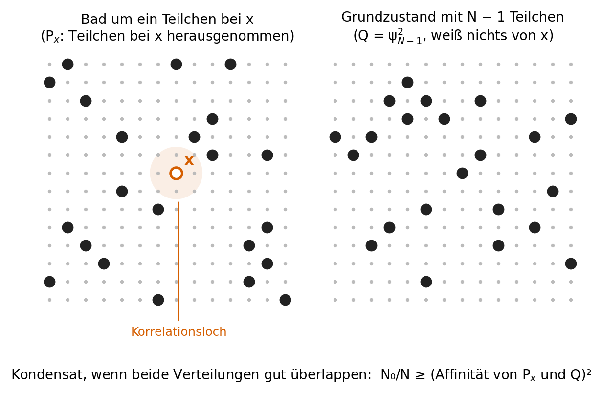
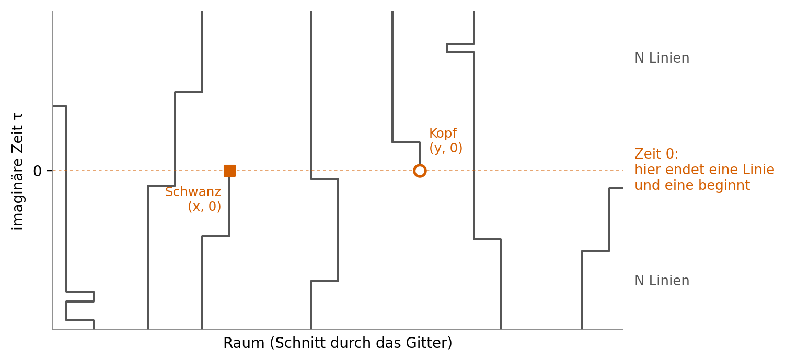
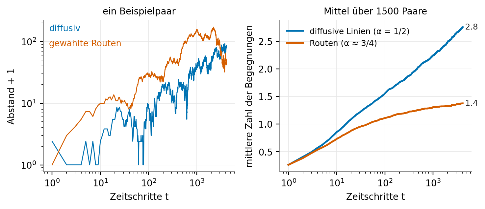
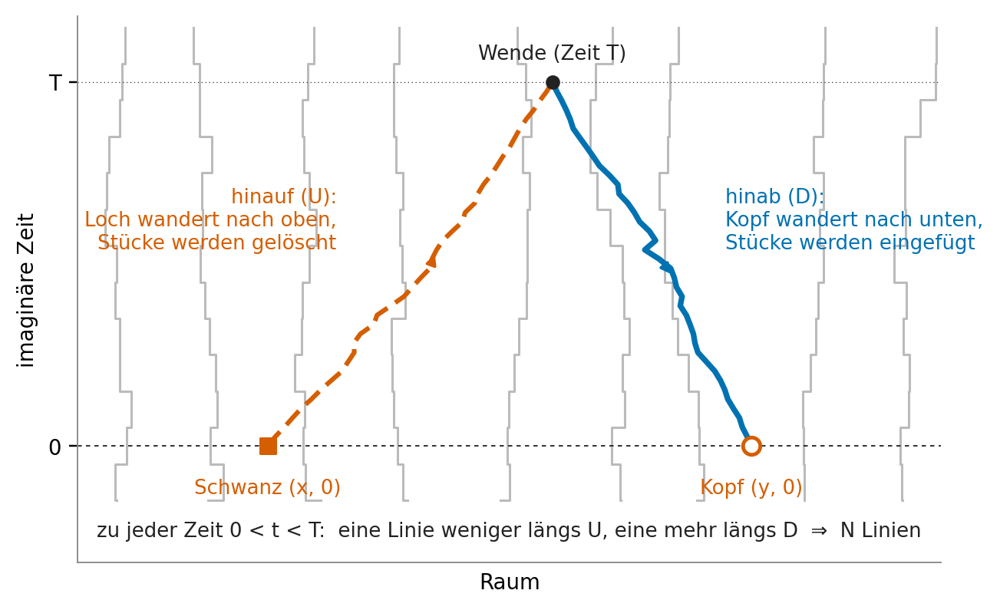
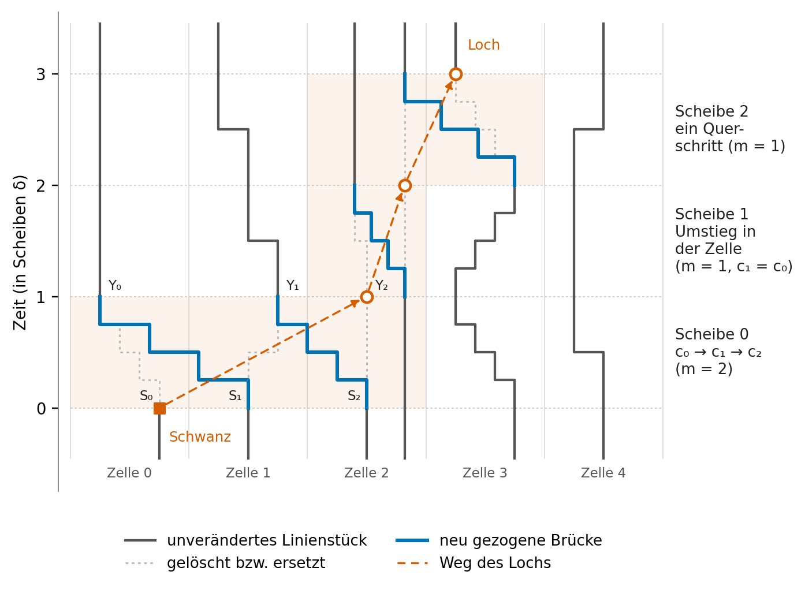
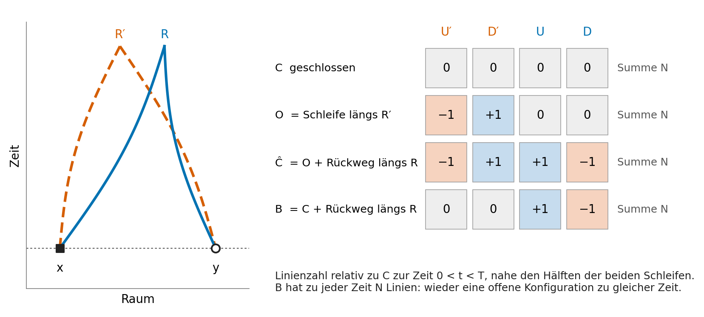

# Kondensat im verdünnten 2D-Gitter-Bosegas: der Beweis zum Nachvollziehen

Tutorial-Fassung 2, 2026-11-10 (Zeitschleife statt Lücke). Grundlage sind das knappe [manuskript\_verduennt.md](manuskript_verduennt.md) mit allen Verweisen und das Arbeitsdokument [einpunkt\_zeitroute.md](einpunkt_zeitroute.md) (§1–§30, alle Herleitungen und Irrwege). Die Musterlösungen der Rechenübungen stehen in [tutorial\_uebungen.py](tutorial_uebungen.py) (nur numpy und scipy, Laufzeit wenige Sekunden), die Abbildungen erzeugt [abbildungen\_tutorial.py](abbildungen_tutorial.py).

## 0. Worum es geht

### 0.1 Der Satz

Harte Bosonen auf einem quadratischen Gitter: Auf jedem Platz sitzt höchstens ein Teilchen, und ein Teilchen springt mit Amplitude 1 auf einen freien Nachbarplatz. Bei halber Füllung (ρ = 1/2) ist langreichweitige Ordnung im Grundzustand streng bewiesen, über Reflexionspositivität [Lit]. Abseits von ρ = 1/2 fehlt diese Symmetrie, und einen strengen Beweis für 2D haben wir in der Literatur nicht gefunden.

**Satz (Ziel).** Es gibt ρ\* > 0 und c > 0 mit folgender Eigenschaft. Für jede Dichte ρ = N/L² mit ρ < ρ\* oder 1 − ρ < ρ\* und jede Gittergröße L ≥ L₀(ρ) gilt im Grundzustand

```text
N₀ / N  ≥  c
```

Dabei ist N₀ die Besetzung des Impulses null (Kap. 1). Ein fester Anteil c aller Teilchen sitzt also im Zustand mit Impuls null, unabhängig von der Systemgröße. Das ist Bose-Einstein-Kondensation im Grundzustand, gleichbedeutend mit langreichweitiger Nichtdiagonalordnung (ODLRO).

**Geltungsbereich** (Fassung vom 2026-11-13; bis 2026-11-12 stand im Satz „für jede Gittergröße L“, Befund W7 in [review\_2026-11-11.md](review_2026-11-11.md)).

- **Große Systeme [S nach OA].** Bewiesen wird der Satz für L ≥ L₀(ρ) = c\_L s(ρ) mit s² = K ln(1/ρ)/ρ und der festen Zahl c\_L = max(16, 2R\*″ + 2), also für N ≥ c\_L² K ln(1/ρ). Die 16 kommt aus dem Staffellauf (Schleifenlänge W ≤ n/8 mit n = L/s, Kap. 4). Der zweite Eintrag sorgt dafür, dass die festen lokalen Umgebungen einer Begegnung (Radius R\*″ Zellen) nicht um den Torus reichen ([anhang\_zweites\_moment.md](anhang_zweites_moment.md), Z.13). Bis 2026-11-13 stand hier L₀ = 16 s(ρ). So formuliert auch die OpenAI-Arbeit ihren Satz.
- **Beliebige Seitenlängen [S].** Ist L kein Vielfaches der Zellseite, teilt man jede Achse ausgeglichen in n = ⌊L/s⌋ Abschnitte. Alle Zellseiten liegen dann in [s, 9s/8], und der Zellgraph bleibt (ℤ/nℤ)². Kästen werden zu Rechtecken mit Seiten b und b + 1 (Lemma 6.3b in Z.13). In allen Schranken ändert das nur feste Faktoren.
- **Sehr kleine Systeme [S].** Die kinetische Energie ist ε\_N = Σ\_k ε(k) ⟨n\_k⟩ mit ε(k) = 4 − 2 cos k₁ − 2 cos k₂ (das gilt auch für harte Bosonen, denn H + 4N = Σ\_k ε(k) b\_k⁺b\_k). Für k ≠ 0 ist ε(k) ≥ ε\_min(L) = 2(1 − cos(2π/L)), und ε\_N ≤ N μ̄ (Lemma 6.5). Also

  ```text
  N₀/N  ≥  1 − ε_N / (N ε_min(L))  ≥  1 − μ̄ / ε_min(L)  ≥  1 − (2,5 κ_μ/π) · N / ln(1/(ρa²))        (L ≥ 4)
  ```

  Für N ≤ (π/(5κ\_μ)) ln(1/(ρa²)) ist also N₀/N ≥ 1/2, ohne jeden Staffellauf. Exakt geprüft auf Tori 6×6 bis 10×10 mit N = 2, 3: N₀/N = 0,92 bis 0,97 gegen die Schranke 0,84 bis 0,94.
- **Dazwischen** (N zwischen etwa 0,6 ln(1/ρ) und c\_L² K ln(1/ρ)) ist der Satz hier nicht bewiesen. Er ist dort sicher richtig; der Staffellauf hat nur nicht genug Zellen, und die elementare Schranke ist zu schwach. Mit der Erhöhung von L₀ am 2026-11-13 ist dieser Bereich größer geworden.

### 0.2 Wie weit der Beweis ist

**Stand 2026-11-14.** Für L ≥ L₀(ρ) ist der Beweis bis auf zwei Sonderfälle geschlossen. Jeder Schritt hat eine genaue Aussage und einen ausgeschriebenen Beweis. Nur skizziert [B] sind zwei Sonderfälle an den Enden der Schleife, in denen sich die auswertende Schleife selbst begegnet (Anhang M, M.9.10): Die Kopfkette wird von beiden Schleifen bis zur Wende geteilt, oder Kopf- und Schwanzende liegen in derselben Scheibe und teilen Stücke. Für beide gibt es einen Plan, der nur Konstanten ändert. Das Übrige ist **[S nach OA]**: Drei Schritte stammen aus der OpenAI-Arbeit zum verdünnten 3D-Bosegas („A density-uniform condensate bound for dilute Bose gases“, 2026, kurz OA). Ihre Beweise sind nachgelesen, und ihre Übertragung auf das Gitter ist geprüft:

- die Übertragung seltener Ereignisse auf das Bezugsmaß (OA Satz 7.3, Anhang G.11.2),
- die Begegnungsschranke für zufällige Schleifen (OA Lemma 8.1, Lemma S1),
- der Randzusammenhang von Zellmengen im Sterngraph (OA Lemma 8.2, dort mit eigenem Paritätsbeweis nach Timár; benutzt in Lemma S2).

Sonst kommt nichts aus der Literatur. Die Gauß-Schranken des Gitterkerns, bis 2026-11-13 der letzte Literatur-Eingang, sind elementar bewiesen (Anhang K). Die Kette aller Voraussetzungen steht in [anhang\_zweites\_moment.md](anhang_zweites_moment.md), Z.12.

**Was das nicht heißt.** Vieles ist nach der ersten Durchsicht ([review\_2026-11-11.md](review_2026-11-11.md)) in wenigen Tagen entstanden, vor allem die Buchführung des zweiten Moments (Anhang M) und die Gitterkern-Schranken (Anhang K). Es ist numerisch gegengeprüft, wo das ging. Eine zweite unabhängige Durchsicht ([review\_2026-11-13.md](review_2026-11-13.md)) fand keinen kritischen Befund und drei wesentliche: Lemma S2 übertrug OAs Umwegkonstruktion nicht wörtlich (W2), die Fortsetzung des Teilens am Schwanz trug nicht (W1), und die Lage des Schnitts am Kopf war nur skizziert (W3). W1 und W2 sind behoben, W3 im Regelfall (Lemma M14f); übrig sind die beiden Sonderfälle oben. Offen ist außerdem der Zwischenbereich der Systemgröße (§0.1).

**Der Weg.** Die erste Fassung ließ eine Lücke in der Zeit wachsen und scheiterte an der Übertragung der Defekt-Schranken auf das Vergleichsmaß (Anhang G.8.4). Die Route läuft deshalb als **Zeitschleife**: hinauf in der Zeit und zurück zur Zeit 0 (Kap. 5, Anhang G.10). Dann liegt der Vergleichszustand im selben Teilchenzahl-Sektor wie das Ziel, und das Werkzeug der OpenAI-Arbeit greift unverändert. Die Kapitel 4 bis 9 erklären die Schritte und geben Beweisideen; die vollständigen Beweise stehen in den Anhängen, die die Tabelle nennt.

| Teil                                                                       | Stand                             | Beweis in                              |
|----------------------------------------------------------------------------|-----------------------------------|----------------------------------------|
| Kondensat als Masse offener Konfigurationen (Kap. 3)                       | [S]                               | Kap. 3                                 |
| Energiewerkzeuge (Kap. 6)                                                  | [S]                               | Kap. 6; Lemma 6.3b in Anhang Z, Z.13   |
| Zeitschleife: Konstruktion und Dichteformel (Kap. 5)                       | [S], exakt geprüft [N]            | Anhang G.12, Anhang L, Lemma M14a      |
| Schleifen-Skelette, orientierte Umwege (Kap. 4, 9)                         | S1, S2 [S nach OA], S3 [S]        | Anhang S                               |
| Dichteschranken (Kap. 7)                                                   | [S]                               | satz\_3\_9 §3, §11, §12; Anhang E      |
| Defekt-Lemma, Peierls-Schranke (Kap. 9)                                    | [S nach OA]                       | satz\_3\_9 §9–§12; Anhang F, U; G.11.2 |
| Ausweichen, Kosten je Begegnung (Kap. 8)                                   | [S]                               | Anhang P, F, U; Lemma C, C′ (G.12.9)   |
| Gitterkern (Gauß-Schranken der Irrfahrt)                                   | [S], ohne Literatur               | Anhang K                               |
| Zweites Moment ∫ f² dµ ≤ C (Satz 5.2)                                      | [S nach OA], zwei Sonderfälle [B] | Anhang Z (Satz Z), Anhang M            |
| Annahme \|ν\| ≥ υ/4, Pflasterung, L ≥ L₀                                   | [S]                               | Anhang Z, Z.12 und Z.13                |
| Zwischenbereich der Systemgröße (§0.1)                                     | offen                             | –                                      |
| Scharfe Stoßkosten, Skalen entkoppeln, Unter-Poisson, Gitter-Lieb–Yngvason | [B] bzw. offen                    | nur für eine bessere Schwelle          |
| Einpunkt-Kriterium, Lücken-Green-Funktion (Kap. 2, 3.3)                    | [S]                               | Hintergrund, im Beweis nicht gebraucht |

Mit den heutigen Konstanten ist ρ\* winzig: nach der Heuristik doppelt exponentiell klein (Kap. 9.3), mit den Konstanten des Beweises nach grober Schätzung dreifach, ρ\* ≈ exp(−exp(10³⁹)) ([beweis\_verlustbilanz.md](beweis_verlustbilanz.md)). Das genügt für den Existenzsatz, ist aber physikalisch bedeutungslos.

### 0.3 Lesehinweise

- **Kennzeichnung:** [S] streng bewiesen, hier oder im genannten Anhang. [S nach OA] bewiesen mit einem Schritt der OpenAI-Arbeit, dessen Beweis nachgelesen und dessen Übertragung geprüft ist. [B] Beweisskizze mit genauer Aussage. [Lit] aus der Literatur. [N] numerisch belegt. [H] Heuristik. „Gegeben …“ nennt die Eingänge eines Beweises.
- **Vorkenntnisse:** Eigenwerte symmetrischer Matrizen, Perron–Frobenius, Irrfahrten auf ℤ², Cauchy–Schwarz, Markov-Ungleichung, Poisson-Prozess. Zweite Quantisierung hilft, ist aber nicht nötig.
- **Aufbau jedes Kapitels:** Bild, Aussage, Beweis, Zahlen, Übungen. Die Lösungen stehen in Anhang B, alle Symbole in Anhang A.
- **Numerierung:** Lemmata werden je Kapitel gezählt. In Klammern steht die Nummer im Manuskript, z. B. „Lemma 6.5 (M 3.5)“.

### 0.4 Der Beweis auf einer Seite

1. **Kondensat als offenes Ende (Kap. 3).** In der Weltlinien-Darstellung ist N₀/N die Gesamtmasse der Konfigurationen, in denen zur Zeit 0 eine Linie bei x endet und eine bei y beginnt, gemittelt über x und y. Zu zeigen ist: Diese Masse ist nicht klein. Kap. 2 erklärt dasselbe im Bild „Teilchen herausnehmen, Rest anschauen“.
2. **Bauen statt messen (Kap. 5.4).** Baut man offene Konfigurationen aus gewöhnlichen, geschlossenen, so ist die gesuchte Masse nach Cauchy–Schwarz mindestens (Erfolgswahrscheinlichkeit)² geteilt durch das zweite Moment der Dichte des Gebauten.
3. **Staffellauf als Zeitschleife (Kap. 5).** Hinauf in der Zeit wird Scheibe für Scheibe ein Linienstück gelöscht, und wenige Nachbarstücke werden neu gezogen, sodass das Loch eine Zelle weiterrückt. Hinab wird Scheibe für Scheibe ein Stück eingefügt, bis der Kopf wieder bei der Zeit 0 steht.
4. **Zufällige Schleifen, zweites Moment (Kap. 4, 5).** Längs einer festen Schleife würden sich Kosten aufmultiplizieren. Mittelt man über zufällige Schleifen, bleiben nur Kosten dort, wo sich zwei unabhängige Schleifen begegnen.
5. **Zwei Querrichtungen (Kap. 4).** Die Raum-Zeit des 2D-Gitters ist ℤ² × ℤ ≅ ℤ³. Jede Hälfte der Schleife schreitet in der Zeit voran und hat zwei räumliche Querrichtungen, und in ℤ³ gibt es Routen, die sich nur endlich oft begegnen (Benjamini–Pemantle–Peres). In 1D gibt es sie nicht, deshalb dort kein Kondensat.
6. **Umgekehrte Einfügung als Bezug (Kap. 5.5).** Damit sich die Kosten fern von Begegnungen exakt wegheben, vergleicht man mit dem Zustand, in dem die zweite Schleife rückwärts durchlaufen ist. Weil die Schleife zur Zeit 0 zurückkehrt, hat dieser Zustand überall N Linien, und die Werkzeuge der OpenAI-Arbeit für seltene schlechte Zellen gelten unverändert.
7. **Verdünnung macht Begegnungen billig (Kap. 7, 8).** In 2D nur logarithmisch: Der kleine Parameter ist 1/ln(1/ρ), die effektive Kopplung des 2D-Bosegases. Dafür braucht man scharfe Energieschranken (Kap. 6) und Dichteschranken (Kap. 7).

## 1. Modell und Bezeichnungen

### 1.1 Gitter, Konfigurationen, Hamilton-Operator

- **Gitter:** Λ = (ℤ/Lℤ)², der L×L-Torus mit M = L² Plätzen. x ∼ y heißt: x und y sind Nachbarn. Jeder Platz hat 4 Nachbarn.
- **Konfiguration:** η ⊂ Λ mit |η| = N, die Menge der besetzten Plätze. ρ = N/M ist die Dichte.
- **Zustandsraum:** ℋ\_N hat die Basis |η⟩ über alle N-Teilmengen, also die Dimension (M über N).
- **Sprungoperator:** (Aφ)(η) = Σ\_{η′ ∼ η} φ(η′). Dabei heißt η′ ∼ η: η′ entsteht aus η, indem ein Teilchen auf einen *freien* Nachbarplatz springt. A ist die Adjazenzmatrix dieses Konfigurationsgraphen.
- **Hamilton-Operator:** H = −A. In zweiter Quantisierung ist das H = −Σ\_{⟨xy⟩} (b\_x⁺ b\_y + b\_y⁺ b\_x) mit Hartkern-Bose-Operatoren: b\_x² = 0, und b\_x, b\_y⁺ vertauschen für x ≠ y.
- **Grundenergie:** E\_N = min spec H auf ℋ\_N. Ein freies Teilchen hat die Energie −4, also ist E\_N ≥ −4N. Die Größe ε\_N = E\_N + 4N ≥ 0 ist die Energie, die der harte Kern kostet. Es gilt ε₁ = 0.

**Lemma 1.1 (Perron) [S].** Für 1 ≤ N ≤ M − 1 ist der Grundzustand ψ\_N eindeutig. Man kann ihn überall positiv wählen, und er ist translationsinvariant.

*Beweis.* A ist elementweise ≥ 0, und der Konfigurationsgraph ist zusammenhängend: Man schiebt Teilchen längs Pfaden an ihre Zielplätze; steht ein anderes Teilchen im Weg, übernimmt es einfach dessen Rolle, denn die Teilchen sind ununterscheidbar. Nach Perron–Frobenius ist der größte Eigenwert von A einfach und hat einen positiven Eigenvektor. Die Translationsinvarianz ist Übung 1.1. ∎

Wir normieren Σ\_η ψ\_N(η)² = 1. Die Positivität ist der Grund, warum der ganze Beweis für Bosonen funktioniert und für Fermionen nicht.

### 1.2 Kondensat

- **Ein-Teilchen-Dichtematrix:** ρ₁(x, y) = ⟨ψ\_N, b\_x⁺ b\_y ψ\_N⟩. Auf der Diagonale ist ρ₁(x, x) = ρ.
- **Impuls null:** b₀ = M^{−1/2} Σ\_x b\_x vernichtet ein Teilchen im Zustand mit Impuls null.
- **Kondensatbesetzung:** N₀ = ‖b₀ ψ\_N‖² = (1/M) Σ\_{x,y} ρ₁(x, y) = Σ\_y ρ₁(0, y). Die letzte Gleichung folgt aus der Translationsinvarianz.
- **Kondensatanteil:** n₀ = N₀/N. Es gilt 0 ≤ N₀ ≤ N (Übung 1.3).

N₀/N ≥ c heißt: Der Mittelwert von ρ₁(0, y)/ρ über alle y ist ≥ c. Weil nur wenige y nahe bei 0 liegen, muss ρ₁(0, y) auch bei großem Abstand von der Ordnung ρ bleiben. Das ist ODLRO im gemittelten Sinn.

### 1.3 Teilchen und Löcher

Die Abbildung |η⟩ ↦ |Λ \ η⟩ tauscht Teilchen und Löcher. Sie bildet ℋ\_N auf ℋ\_{M−N} ab und vertauscht mit A: Springt ein Teilchen von x nach y, springt ein Loch von y nach x. Für x ≠ y stimmen die Dichtematrizen bei N und M − N Teilchen überein (Übung 1.2). Der Fall 1 − ρ < ρ\* folgt also aus dem Fall ρ < ρ\*. Ab hier sei ρ klein.

### Übungen zu Kapitel 1

- **Ü 1.1** Zeige, dass ψ\_N translationsinvariant ist.
- **Ü 1.2** Zeige ρ₁^{(N)}(x, y) = ρ₁^{(M−N)}(x, y) für x ≠ y. Was folgt für N₀ bei N und M − N Teilchen?
- **Ü 1.3** Zeige N₀ ≤ N und ⟨b₀b₀⁺⟩ = N₀ + 1 − 2ρ.

## 2. Hintergrund: Ein Punkt genügt

Dieses Kapitel erklärt, was Kondensat im Bild der Konfigurationen heißt, und liefert die Messgröße Z₀. Für den Beweis selbst wird es nicht mehr gebraucht: Die Zeitschleife (Kap. 5) schätzt N₀/N direkt ab, über Lemma 3.2.

### 2.1 Bild

Man zieht eine Konfiguration aus ψ\_N², bedingt darauf, dass bei x ein Teilchen sitzt, und schaut den Rest an: N − 1 Teilchen, das „Bad“. Ist dieses Bad im Wesentlichen dasselbe wie der Grundzustand mit N − 1 Teilchen, dann gibt es Kondensat. Der Vergleichszustand ψ\_{N−1} weiß nichts von x.

Gemessen wird „im Wesentlichen dasselbe“ mit der **Affinität** (Bhattacharyya-Koeffizient) zweier Wahrscheinlichkeitsverteilungen:

```text
H(P, Q) = Σ_σ √( P(σ) Q(σ) )        0 ≤ H ≤ 1,   H = 1 ⇔ P = Q,   H = 0 ⇔ disjunkte Träger
```



**Abb. 1.** Links eine Konfiguration unter P\_x: Bei x saß ein Teilchen, es ist herausgenommen (offener Kreis). Um x ist das Bad etwas ausgedünnt, das Korrelationsloch. Rechts eine Konfiguration des Grundzustands mit N − 1 Teilchen, der nichts von x weiß. Schematisch gezeichnet, keine echten Stichproben. Kondensat heißt: Die beiden Verteilungen überlappen gut, die Affinität ist nicht klein.

### 2.2 Aussage

Für eine (N−1)-Menge σ ∌ x seien

```text
P_x(σ) = ψ_N(σ ∪ {x})² / ρ          (Bad um ein Teilchen bei x, „Palm-Maß“)
Q(σ)   = ψ_{N−1}(σ)²                (Grundzustand mit einem Teilchen weniger)
H̄      = H(P_x, Q)                   (wegen Translationsinvarianz unabhängig von x)
```

**Lemma 2.1 (Einpunkt-Kriterium, M 2.1) [S].**

```text
N₀/N  ≥  H̄²          und punktweise          ρ₁(x, y)/ρ  ≥  2H̄² − 1   für alle x ≠ y
```

*Beweis.*

1. **P\_x ist normiert:** Σ\_{σ ∌ x} ψ\_N(σ ∪ x)² = ⟨n\_x⟩ = ρ.
2. **Überlapp:** ⟨ψ\_{N−1}, b₀ ψ\_N⟩ = M^{−1/2} Σ\_x Σ\_σ ψ\_{N−1}(σ) ψ\_N(σ ∪ x). Wegen der Positivität ist ψ\_{N−1}(σ) ψ\_N(σ ∪ x) = √ρ · √(P\_x(σ) Q(σ)). Die Summe über σ gibt √ρ H̄ für jedes x, die Summe über x den Faktor M. Zusammen: M^{1/2} √ρ H̄ = √N H̄.
3. **Cauchy–Schwarz:** ψ\_{N−1} ist ein Einheitsvektor, also |⟨ψ\_{N−1}, b₀ψ\_N⟩|² ≤ ‖b₀ψ\_N‖² = N₀. Mit Schritt 2 folgt N H̄² ≤ N₀.
4. **Punktweise:** a\_x(σ) = ψ\_N(σ ∪ x)/√ρ ist ein Einheitsvektor mit ⟨a\_x, a\_y⟩ = ρ₁(x, y)/ρ und ⟨a\_x, ψ\_{N−1}⟩ = H̄. Zerlege a\_x = H̄ ψ\_{N−1} + √(1 − H̄²) e\_x mit e\_x ⟂ ψ\_{N−1} und ‖e\_x‖ = 1. Dann ist ⟨a\_x, a\_y⟩ = H̄² + (1 − H̄²)⟨e\_x, e\_y⟩ ≥ H̄² − (1 − H̄²). ∎

**Gleichheitsfall.** In Schritt 3 gilt Gleichheit genau dann, wenn b₀ψ\_N parallel zu ψ\_{N−1} ist. Das Verhältnis Z₀ = N H̄²/N₀ ist der Anteil von b₀ψ\_N im Grundzustand, physikalisch das Quasiteilchengewicht bei Impuls null.

### 2.3 Zahlen

| System            | ρ      | N₀/N    | H̄²      | Z₀            | Quelle                       |
|-------------------|--------|---------|---------|---------------|------------------------------|
| 4×4, N = 3, exakt | 0,1875 | 0,85083 | 0,85041 | 0,99951       | tutorial\_uebungen.py        |
| 5×5, N = 3, exakt | 0,12   | 0,89238 | 0,89213 | 0,99972       | tutorial\_uebungen.py        |
| 6×6, N = 6, exakt | 0,167  | 0,80948 | 0,80850 | 0,99879       | einpunkt\_kriterium.py       |
| 16×16, Wurm       | 1/16   | –       | –       | 1,001 ± 0,003 | auswertung\_gtau.py          |
| 16×16, Wurm       | 1/8    | –       | –       | 1,000 ± 0,004 | auswertung\_gtau.py          |
| 32×32, Wurm       | 1/16   | 0,790   | –       | 0,983 ± 0,011 | auswertung\_gtau.py, 2 Seeds |

- **2D:** Das Kriterium verliert praktisch nichts, auch bei großen Systemen [N]. H̄² ist also gleich dem Kondensatanteil, und der ist bei ρ = 1/16 gemessen 0,790 (L = 32), auf L → ∞ hochgerechnet etwa 0,75 (README, Runde 1). Bis 2026-11-13 stand in der Tabelle der hochgerechnete Wert (Review H2).
- **1D zum Vergleich:** H̄² fällt wie L^{−1/2}, und es gibt kein Kondensat. Das Kriterium meldet also nichts Falsches.

### Übungen zu Kapitel 2

- **Ü 2.1** Rechne N₀/N, H̄² und Z₀ für 3×3 und 4×4 mit N = 2 sowie für 4×4 mit N = 3 nach. Warum ist Z₀ für N = 2 *exakt* 1?

## 3. Schritt 1: Kondensat als offene Weltlinie

### 3.1 Weltlinien

Entwickelt man e^{τA} = Σ\_n τⁿ Aⁿ/n!, so ist das Matrixelement ⟨η′| e^{τA} |η⟩ eine Summe über Folgen von Sprüngen η → η₁ → … → η′. Jede Folge mit n Sprüngen trägt das Volumen ∫\_{0 < t₁ < … < tₙ < τ} dt₁ ⋯ dtₙ bei.

Eine solche Sprunggeschichte zeichnet man in Raum-Zeit (Raum waagrecht, imaginäre Zeit senkrecht): Jedes Teilchen hinterlässt eine **Weltlinie**, die senkrecht läuft und bei jedem Sprung auf einen Nachbarplatz versetzt. Der harte Kern heißt: Zwei Linien sind nie zur selben Zeit am selben Platz.

- **Gewicht:** genau 1 je Sprung, also das Lebesgue-Maß der Sprungzeiten. Es gibt keinen weiteren Faktor, weil H keinen Diagonalteil hat.
- **Grundzustand:** Lässt man die Zeit von −∞ bis +∞ laufen, erhält man ein stationäres Maß auf Weltlinien-Konfigurationen. Zu jeder Zeit ist die Konfiguration nach ψ\_N² verteilt. Als Prozess ist es eine Markov-Kette mit Sprungraten ψ\_N(η′)/ψ\_N(η) für η → η′ (Doob-Transformation, Übung 3.2).

**Lemma 3.1 (Markov-Eigenschaft in Raum-Zeit) [S].** Sei R ein Raum-Zeit-Gebiet. Gegeben die Konfiguration außerhalb von R, ist das Innere gleichverteilt (Lebesgue-Maß der Sprungzeiten) über alle Geschichten, die zu den Randdaten passen. Randdaten sind die Besetzung auf Boden und Deckel und die Sprünge über den räumlichen Rand. Die Normierung Z\_R(∂) heißt **bedingte Zustandssumme**.

*Beweis.* Das Gewicht ist ein Produkt: ein Faktor dt je Sprung, mal die Indikatorfunktion „kein Stoß“. Ein Stoß ist ein Ereignis an *einem* Raum-Zeit-Punkt. Gegeben die Randdaten, zerfallen also beide Faktoren in einen Anteil innen und einen außen. ∎

Diese Eigenschaft ist das Hauptwerkzeug des Staffellaufs: Man darf ein Linienstück aus seinem *exakt normierten* bedingten Gesetz neu ziehen, ohne den Rest zu stören.

### 3.2 Das Kondensat als Masse offener Konfigurationen

Die Ein-Teilchen-Dichtematrix ρ₁(x, y) = ⟨b\_y⁺ b\_x⟩ (gleich ⟨b\_x⁺ b\_y⟩, weil ψ\_N reell ist) hat ein einfaches Weltlinienbild. Zur Zeit 0 wird bei x ein Teilchen vernichtet und bei y eines erzeugt. Also endet bei (x, 0) eine Linie (der **Schwanz**), und bei (y, 0) beginnt eine (der **Kopf**). Sonst laufen überall N Linien. Das ist eine **offene Konfiguration zu gleicher Zeit**. Genau solche Konfigurationen erzeugt der Wurm-Algorithmus, wenn Kopf und Schwanz zur gleichen Zeit stehen.



**Abb. 2.** Weltlinien in Raum-Zeit, der Raum nur als Schnitt gezeichnet. Zur Zeit 0 endet eine Linie am Platz x (Schwanz), und eine beginnt am Platz y (Kopf). Darüber und darunter laufen N Linien. Das Gewicht solcher Bilder ist ρ₁(x, y).

**Das Zielmaß µ** (wie in der OpenAI-Arbeit): Man wählt den Schwanz unter den N Teilchen zur Zeit 0 (Gewicht 1/N) und den Kopf unter allen M Plätzen (Gewicht 1/M). Eine offene Konfiguration O hat dann das Gewicht µ(O) = W(O)/(N M Z\_N), mit W(O) dem Weltlinien-Gewicht und Z\_N der Zustandssumme.

**Lemma 3.2 (Kondensat als Masse) [S].** |µ| = N₀/N.

*Beweis.* Summiert man W/Z\_N über alle offenen Konfigurationen mit Schwanz x und Kopf y, erhält man ⟨b\_y⁺ b\_x⟩ = ρ₁(x, y) (Dyson-Entwicklung mit b\_x und b\_y⁺ zur Zeit 0, im Grenzfall β → ∞). Also ist |µ| = (1/(NM)) Σ\_{x,y} ρ₁(x, y) = N₀/N nach Kap. 1.2. ∎

**Neue Zielaussage.** Zu zeigen ist |µ| ≥ c. Eine untere Schranke für eine Masse kann man durch eine *Konstruktion* beweisen: Man baut offene Konfigurationen aus geschlossenen und kontrolliert, wie stark das gebaute Maß von µ abweicht (Kap. 5).

### 3.3 Bemerkung: die Lücke in der Zeit

Schiebt man den Kopf in der Zeit nach oben, auf (y, τ), dann fehlt zwischen 0 und τ eine Linie: eine **Lücke der Länge τ**. Ihr über x und y gemitteltes Gewicht ist die Lücken-Green-Funktion

```text
G(τ) = ⟨ b₀ψ_N ,  e^{−τ(H − E_{N−1})}  b₀ψ_N ⟩          (H wirkt hier im Sektor mit N − 1 Teilchen)
```

**Lemma 3.3 [S].** G ist vollständig monoton in τ. Es gilt G(0) = N₀ und G(τ) ↓ N H̄² für τ → ∞.

*Beweis.* Spektralzerlegung: G(τ) = Σ\_n |⟨n, b₀ψ\_N⟩|² e^{−τ(E\_n − E\_{N−1})}. Jeder Summand ist ≥ 0 und vollständig monoton. Für τ → ∞ bleibt nur der Grundzustand ψ\_{N−1}, mit Gewicht |⟨ψ\_{N−1}, b₀ψ\_N⟩|² = N H̄² (Lemma 2.1). ∎

Dieses Lemma liefert die Wurm-Messung Z₀ ≈ 1 in Kap. 2.3. Die erste Fassung des Beweises benutzte es, um eine lange Lücke statt der offenen Konfiguration zu bauen. Diese Fassung scheiterte an einem Teilschritt (Anhang G.8.4). Die Zeitschleife in Kap. 5 kommt ohne Lücke am Ende aus.

### Übungen zu Kapitel 3

- **Ü 3.1** Begründe mit der Dyson-Entwicklung, dass die offenen Konfigurationen mit Schwanz x und Kopf y zusammen das Gewicht ρ₁(x, y) haben, und folgere |µ| = N₀/N.
- **Ü 3.2** Zeige: Die Raten ψ(η′)/ψ(η) für η → η′ ergeben eine Markov-Kette, deren Gesamtrate aus jeder Konfiguration gleich |E\_N| ist und die ψ² als reversibles Maß hat.
- **Ü 3.3** Rechne G(τ) für 4×4 mit N = 3 aus der Spektralzerlegung. Prüfe G(0) = N₀ und G(∞) = N H̄². Warum fällt G so schnell auf seinen Endwert?

## 4. Schritt 2: Warum 2D plus Zeit wie 3D ist

### 4.1 Wozu Routen, und warum durch die Zeit?

Das offene Ende muss vom Schwanz x zu einem Kopf y gebracht werden, beide zur Zeit 0. Der Kopf darf nicht an wenigen Plätzen hängen bleiben, sondern muss breit verteilt sein, weil µ über alle Kopfplätze mittelt.

- **Eine Route nur in der Ebene zur Zeit 0** wäre ein Pfad in ℤ² mit nur *einer* Querrichtung. Das sind zu wenige (Tabelle in 4.2).
- **Deshalb verlässt die Route die Zeit 0**: Sie läuft in imaginärer Zeit hinauf und wieder zurück, eine **Zeitschleife**. Die Aufwärts-Hälfte U führt von der Zelle von x zur Zeit 0 zu einer Wendezelle zur Zeit T. Die Abwärts-Hälfte D führt von dort zur Zelle von y zur Zeit 0.
- **Jede Hälfte** schreitet in der Zeit voran (U aufwärts, D abwärts) und schwankt in den *beiden* Raumrichtungen. Das sind zwei Querrichtungen.

**Warum zufällig?** Konstruiert man die offene Konfiguration längs *einer* festen Schleife, „erinnert“ sie sich an diese Schleife. Das gebaute Maß ist dann auf eine dünne Menge konzentriert, und seine Dichte bezüglich µ wird riesig. Mittelt man über viele Schleifen, verteilt sich das Maß. Im zweiten Moment, also bei ∫ (Dichte)², treten zwei unabhängige Schleifen R und R′ auf. Fern voneinander heben sich ihre Beiträge exakt auf (Kap. 5); wo sie sich begegnen, kostet jede Begegnung höchstens einen Faktor e^θ. Gebraucht wird also

```text
E[ e^{θ J} ]  ≤  C        gleichmäßig in der Länge der Schleifen,
J = Zahl der Begegnungen zweier unabhängiger Schleifen
```

### 4.2 Begegnungen zählen

Ein zeitlich orientierter Pfad schreitet in der Zeit voran und schwankt in q Querrichtungen. Seine Querauslenkung nach t Schritten sei von der Ordnung t^α. Zwei unabhängige Pfade sind zur Zeit t mit Wahrscheinlichkeit ~ t^{−qα} am selben Ort. Die mittlere Zahl der Begegnungen Σ\_t t^{−qα} ist endlich genau dann, wenn qα > 1 (Übung 4.2).

| Fall      | Raum-Zeit   | Querrichtungen q | physikalische Linien (α = 1/2) | gewählte Routen (α = 3/4) | Kondensat |
|-----------|-------------|------------------|--------------------------------|---------------------------|-----------|
| 1D, T = 0 | ℤ × ℤ ≅ ℤ²  | 1                | divergent                      | divergent                 | nein      |
| 2D, T = 0 | ℤ² × ℤ ≅ ℤ³ | 2                | grenzwertig (logarithmisch)    | endlich                   | ja        |
| 3D, T = 0 | ℤ³ × ℤ      | 3                | endlich                        | endlich                   | ja        |

- **Physikalische Linien** wandern diffusiv. In 2D begegnen sich zwei davon logarithmisch oft (Übung 4.1). Man kann das offene Ende also nicht einfach mit einer Linie mitfahren lassen.
- **Gewählte Routen** dürfen superdiffusiv sein: Das Loch steigt von Linie zu Linie um (Kap. 5). Mit α = 3/4 ist qα = 3/2 > 1.
- **Bei T > 0** ist die Zeitrichtung ein Kreis der Länge β, also eine Platte statt ℤ³. Die Schleife kann höchstens die Höhe β/2 erreichen, und solche Routen gibt es nicht (Häggström–Mossel) [Lit]. In 2D gibt es dort auch kein Kondensat.



**Abb. 3.** Simulation [N] (abbildungen\_tutorial.py). Blau: zwei unabhängige Irrfahrten auf ℤ². Orange: zwei unabhängige Routen nach Häggström–Mossel mit β = 1/4; auf Stufe l bleibt die Richtung über Zeitblöcke der Länge 2^l gleich, und in jedem Schritt wird Stufe l mit Gewicht 2^{−l/4} gewählt. Links ein Beispielpaar, rechts die mittlere Zahl der Begegnungen (gleicher Platz zur gleichen Zeit) über 1500 Paare. Die diffusiven Linien begegnen sich immer wieder, ihre Zahl wächst wie (1/π) ln t. Bei den Routen wächst sie zwischen t = 512 und 4096 nur noch um 0,1 statt um 0,7.

Ein endlicher *Mittelwert* von J genügt nicht, man braucht ein exponentielles Moment. Das liefert der folgende Satz.

**Satz 4.1 (Benjamini–Pemantle–Peres 1998) [Lit].** Es gibt ein Wahrscheinlichkeitsmaß auf orientierten Pfaden in ℤ³ (jeder Schritt geht in der dritten Koordinate um 1 vorwärts) und ein θ₀ > 0, sodass zwei unabhängige Pfade E e^{θ₀ J} < ∞ erfüllen. Für orientierte Pfade in ℤ² ist das unmöglich.

**Schleifen [S nach OpenAI].** Zwei unabhängige Schleifen begegnen sich auf vier Arten: U–U′, D–D′, U–D′ und D–U′. Die Konstruktion zwischen festen Endpunkten auf dem Zellgitter ist die aus §8.1 der OpenAI-Arbeit (dyadische Geschwindigkeiten nach Häggström–Mossel), und sie ist dort schon eine Schleife: Die zufällige Querabweichung wird bis zur Mitte vorwärts und danach rückwärts gelesen. Nimmt man die Zeit als erste Koordinate, sind die beiden Hälften U und D. Die Paarungen U–D′ und D–U′ gibt es bei OpenAI nicht, weil dort Hin- und Rückhälfte an verschiedenen Orten liegen. OpenAIs Beweis braucht aber nur eine Dichteschranke, die feste Verschiebungen nicht sieht, und trägt deshalb auch für sie (Anhang G.11.3).

### 4.3 Das Budget

Die größte zulässige Kosten-Rate heißt **Budget** α\_max: E e^{θJ} ist beschränkt für θ < α\_max. Kostet jede Begegnung einen Faktor 1 + c, braucht man ln(1 + c) < α\_max. Numerisch für unsere Routenfamilie [N] (skelett\_budget.py, skelett\_budget2.py):

- α\_max ≈ 0,046 mit harten Kosten je nahem Zellpaar;
- α\_max ≈ 0,07 für die ganze Route und ≈ 0,11 im Inneren, mit weichen Abstandsgewichten;
- Querdrift kostet Budget: Bei Drift 0,5 Zellen je Schritt sinkt es auf 0,004. Für den Existenzsatz genügt jedes positive Budget. Man nimmt dann OpenAIs Bereich: Schleifenhöhe T ≈ L s/16, Endpaare mit Abstand ≤ L/8, Drift ≤ 1 Zelle je Scheibe (Anhang G.11.3);
- **steile** Hälften (T ≫ L s, kaum Querdrift) würden das Budget verbessern. Dann läuft die Querabweichung aber um den Torus, und man braucht eine Torus-Fassung der Begegnungsschranke. Sie gilt für Schleifen mit höchstens n² Scheiben (n = L/s), ist aber nur skizziert und nur für eine bessere Schwelle nötig.

### Übungen zu Kapitel 4

- **Ü 4.1** Zwei unabhängige Irrfahrten in stetiger Zeit auf ℤ^q (Rate 1 je Nachbar). Zeige: Die mittlere gemeinsame Aufenthaltszeit am selben Platz ist endlich genau für q ≥ 3. Wie wächst sie in q = 2 mit der Zeit?
- **Ü 4.2** Begründe die Bedingung qα > 1 für endlich viele Begegnungen superdiffusiver Routen.

## 5. Schritt 3: Der Staffellauf als Zeitschleife

### 5.1 Skalen

| Größe             | Wahl                 | Rolle                                                          |
|-------------------|----------------------|----------------------------------------------------------------|
| Teilchenabstand r | ρ^{−1/2}             | mittlerer Abstand zweier Teilchen                              |
| Zellseite s       | ρ s² = m = K ln(1/ρ) | eine Zelle enthält im Mittel m Teilchen                        |
| Zeitscheibe δ     | δ ≈ s²               | in der Zeit δ wandert eine Linie etwa eine Zellseite           |
| Schleifenhöhe T   | T = w δ ≈ L s/16     | w Scheiben hinauf und w hinab; OpenAIs Bereich (Anhang G.11.3) |

Die Konstante K legt fest, wie viele Teilchen eine Zelle hat. Ihre Größe bestimmen die Dichteschranken (Kap. 7).



**Abb. 4.** Die Zeitschleife schematisch. Hinauf (orange) wandert das Loch vom Schwanz bis zur Wende zur Zeit T; dabei werden Linienstücke gelöscht. Hinab (blau) wandert der Kopf zurück zur Zeit 0; dabei werden Linienstücke eingefügt. Zu jeder Zeit fehlt eine Linie längs des Aufwegs, und eine ist längs des Abwegs dazugekommen.

### 5.2 Hinauf: Löschen

In Scheibe k liegt die Route auf einem Sternpfad von Zellen c₀, c₁, …, c\_m (meist m ≤ 4). In jeder Zelle c\_l, l ≥ 1, wählt man ein **wählbares** Teilchen j\_l. Sein Linienstück in dieser Scheibe endet bei Y\_l in c\_l (ein Stück gehört zur Zelle seines Endes) und beginnt bei S\_l höchstens D Zellseiten davon entfernt. Es verlässt diese Umgebung nicht, und Anfang und Ende haben Abstand zu anderen Teilchen. In einer brauchbaren Zelle ist ein Anteil von mindestens 1 − ε der Teilchen wählbar. Das Stück j₀ am Loch wird nicht gewählt. Es ist trotzdem regulär (isolierte Enden, nicht weit gewandert): Das letzte Teilchen j\_m jeder Scheibe wird nur unter Teilchen gewählt, deren Stück in der *folgenden* Scheibe regulär ist, und dieses Stück ist das nächste j₀ ([anhang\_lochstueck.md](anhang_lochstueck.md), Anhang L). Die Endzelle von j₀ ist der Anfang c₀ des Sternpfads. Die genauen Festlegungen stehen in [anhang\_gegenluecke.md](anhang_gegenluecke.md) G.5.1.



**Abb. 5.** Die Aufwärts-Hälfte über drei Zeitscheiben, der Raum als Schnitt gezeichnet. Scheibe 0: Das Stück S₀ → Y₀ wird gelöscht, die Brücken S₁ → Y₀ und S₂ → Y₁ werden neu gezogen. Bei Y₂ kommt keine Linie mehr an; das Loch ist von Zelle 0 nach Zelle 2 gerückt. Scheibe 1: Umstieg innerhalb der Zelle (c₁ = c₀, Punkt 4 unten). Das Stück, das bei Y₂ beginnt, wird gelöscht, und das Stück eines zweiten Teilchens derselben Zelle wird als Brücke an sein Ende umgehängt. Das Loch springt auf das alte Ende dieses Teilchens. Scheibe 2: ein Querschritt nach Zelle 3. Hell hinterlegt sind die Zellen der Route.

1. **Löschen:** Das Stück von j₀ wird gelöscht. Das Loch steht am Boden bei S₀. Das ist genau das Loch, das die vorige Scheibe an ihrem Deckel hinterlassen hat.
2. **Zyklisch verschieben:** Für l = 1, …, m wird das Stück von j\_l neu gezogen, als Brücke von S\_l nach Y\_{l−1}. Gezogen wird aus dem exakt normierten bedingten Gesetz bei festgehaltenem Rest (Lemma 3.1).
3. **Ergebnis:** Am Deckel fehlt die Linie bei Y\_m. Das Loch ist von c₀ nach c\_m weitergerückt.
4. **In jeder Scheibe wird umgestiegen** (m ≥ 1), notfalls innerhalb der Zelle (c₁ = c₀, j₁ ≠ j₀). So ist das Lochstück der nächsten Scheibe immer die Fortsetzung eines gewählten Teilchens, und für dieses wurde eine Scheibe vorausgeschaut. Bis 2026-11-11 war auch m = 0 erlaubt; dann fuhr das Loch auf der Linie von j₀ mit, und über deren nächstes Stück wusste man nichts (Befund K3 des Reviews, Anhang L).

Nach w Scheiben steht das Loch bei der Wende zur Zeit T. Bis dahin fehlt zwischen 0 und T eine Linie: Es ist vorübergehend eine Lücke entstanden.

### 5.3 Hinab: Einfügen, als Spiegelbild

Die Abwärts-Hälfte schließt die Lücke von oben wieder, Scheibe für Scheibe. Sie ist das Spiegelbild des Aufwegs:

1. **Zug wählen:** Der Kopf steht oben in der Scheibe bei Y₀, in der Zelle e₀. Man wählt einen Zug d der Route, also einen Sternpfad e₀, e₁, …, e\_m.
2. **Umsteigen:** In jeder Zelle e\_l, l ≥ 1, wählt man ein wählbares Teilchen j\_l. Sein Stück wird als Brücke S\_l → Y\_{l−1} neu gezogen, mit Y\_l dem alten Ende von j\_l. Jetzt endet eine Linie beim alten Kopf, und das alte Ende Y\_m von j\_m ist frei.
3. **Einfügen mit neuem Anfang:** Ein neues Stück endet bei Y\_m. Sein Anfang S′ wird zusammen mit dem Stück und den Brücken aus dem exakt normierten bedingten Gesetz gezogen (Lemma 3.1). S′ läuft dabei über die Plätze im Abstand ≤ D\_c s von Y\_m, die zur Zeit t\_k Abstand > r von allen Teilchen haben (**Variante c**, Anhang G.12.9). Der Anfang kommt also dorthin, wo eine Linie mit Ende Y\_m natürlicherweise herkäme, nur nicht zu weit weg und nicht zu nah an anderen Teilchen.
4. **Ergebnis:** Der Kopf steht eine Scheibe tiefer, bei S′. Im Abweg macht man in jeder Scheibe einen Querschritt (m ≥ 1). Er mischt den Kopf über die Zellen und begrenzt, wie lange zwei Schleifen das unterste Kopfstück teilen (Anhang G.12.7).

Nach w Scheiben steht der Kopf zur Zeit 0, bei y. Das Ergebnis O ist eine offene Konfiguration zu gleicher Zeit: Schwanz bei (x, 0), Kopf bei (y, 0). Zu jeder Zeit zwischen 0 und T fehlt längs des Aufwegs ein Linienstück, und längs des Abwegs ist eines dazugekommen. Die Linienzahl ist also überall N. Gelingt ein Schritt nicht (keine wählbaren Teilchen), wird verworfen.

**Warum ein Spiegelbild und kein einfaches Einfügen?** Die erste Fassung setzte den neuen Kopf einfach gleichverteilt in die Zelle des alten, ohne Querschritte. Dann läuft die eingefügte Linie in O eine feste Zellsäule entlang. Unter µ ist das selten: In einer Scheibe bleibt eine Linie nur mit Wahrscheinlichkeit 0,07–0,25 in ihrer Zelle. Das gebaute Maß sitzt dann auf einer dünnen Menge, und ∫ f² dµ wächst je Scheibe um den Faktor 4,5–14, für ein Teilchen exakt gerechnet (Anhang G.11.1). Beim Spiegelbild ist der Weg dagegen in O versteckt wie beim Aufweg: Man sieht O nicht an, welche Stücke eingefügt und welche umgehängt wurden. Rückwärts gelesen ist der Abweg ein Lösch-Staffellauf, der vom Kopf aus nach oben läuft.

**Warum der Anfang im Ball und nicht in der Zelle?** Die Fassung bis 2026-11-10 (Variante a) zog S′ gleichverteilt in der Zelle von Y\_m. Ein Testmodell auf dem 2D-Torus (Anhang Z, Z.11) zeigt, dass das teuer ist: Eine Linie mit Ende Y\_m kommt oft aus einer Nachbarzelle, und die Beschränkung auf die Zelle kostet je Scheibe wieder etwa 1/P(bleiben), wie beim eingeengten Abweg. Wie S′ *innerhalb* der Zelle verteilt ist, spielt dagegen kaum eine Rolle. Mit dem Ball um Y\_m fallen die Kosten mit dem Radius auf 1 (Faktor je Scheibe 2,11; 1,17; 0,99 für Radius 1, 2, 3 bei erlaubtem Querschritt; mit Querschritt in jeder Scheibe 2,77; 1,36; 1,13). Im Beweis kostet eine von zwei Schleifen geteilte Kopfscheibe dann ≤ 2 statt ≤ 14 (Lemma C). Der Querschritt bleibt nötig: Ohne ihn wächst ∫f² im Testmodell auch mit dem Ball um 1,22 je Scheibe.

### 5.4 Vom gebauten Maß zur Kondensatmasse

P sei das geschlossene Wahrscheinlichkeitsmaß und R eine zufällige Schleife. ν ist das Bild von P unter dem Staffellauf. Seine Masse |ν| ist die Annahmewahrscheinlichkeit. ν hat eine Dichte f = dν/dµ bezüglich des Zielmaßes µ.

**Lemma 5.1 (gemeinsames Maß, M 5.2) [S].**

```text
|ν|²  ≤  |µ| · ∫ f² dµ,        also        N₀/N  =  |µ|  ≥  |ν|² / ∫ f² dµ
```

*Beweis.* Cauchy–Schwarz: |ν| = ∫ f · 1 dµ ≤ (∫ f² dµ)^{1/2} (∫ 1 dµ)^{1/2}; dann Lemma 3.2. ∎

Die OpenAI-Arbeit benutzt die allgemeinere Form für zwei Maße P und Q: H(P, Q) ≥ |ν|²/√(C\_P C\_Q) mit C\_P = ∫ (dν/dP)² dP (Übung 5.1).

**Die Dichte f** hat eine geschlossene Form: je Scheibe ein Quotient bedingter Zustandssummen, beim Löschen wie beim Einfügen (Anhang G.2 und G.11.1). An einem Mini-System (Ring mit 6 Plätzen) ist diese Formel exakt geprüft: Auf allen bis zu 133 000 offenen Konfigurationen stimmen ν und f·µ bis auf Rundungsfehler (≤ 7·10⁻¹⁶) überein. Am selben Mini-System bleibt die Ausbeute |ν|²/∫f² mit dem Spiegel-Abweg stabil, wenn die Schleife höher wird; mit dem eingeengten Abweg der ersten Fassung fällt sie je Scheibe um den Faktor 0,6–0,8. Ein größeres Testmodell auf dem 2D-Torus (6×4 Plätze, 6 Teilchen, bis zu einer Million Proben je Punkt) bestätigt die Formel exakt (Fehler ≤ 10⁻¹⁵) und misst, wie stark ∫ f² dµ je Scheibe wächst: mit Variante a um den Faktor 3–4, mit Variante c (Radius 3) um 1,13 bei Querschritt in jeder Scheibe und gar nicht messbar bei nur erlaubtem Querschritt (Anhang Z, Z.11). Dort teilen sich die beiden Kopien jede Scheibe; im Beweis kostet nur eine Begegnung, und die wird mit vielen Teilchen je Zelle billig.

**Was zu zeigen bleibt.** |ν| ≥ a₀ > 0 (genug wählbare Teilchen, Kap. 7) und ∫ f² dµ ≤ C (zweites Moment). Dann ist N₀/N ≥ a₀²/C.

### 5.5 Das zweite Moment und die umgekehrte Einfügung

Es gilt ∫ f² dµ = ∫ f dν, und f selbst ist ein Mittel über die Schleifen, die O erzeugt haben könnten. Damit wird das zweite Moment ein Mittel über *zwei unabhängige* Schleifen: R′ baut O, R wertet die Dichte aus.

**Das Problem.** Vergleicht man O naiv mit der geschlossenen Konfiguration, kostet jede Zelle der Schleife einen Faktor: Hier fehlt ein Teilchen, dort ist eines zu viel. Diese Faktoren schwanken mit der Umgebung, und ihr Produkt über ~L Zellen hätte eine Varianz, die mit der Länge wächst.

**Der Ausweg: umgekehrte Einfügung** (nach der „reverse insertion“ der OpenAI-Arbeit). Als Bezug nimmt man den Zustand B: die geschlossene Konfiguration C, auf die man den *Rückweg* längs R anwendet. Längs U kommt ein Linienstück dazu, längs D fällt eines weg. Die Linienzahlen zu einer Zeit 0 < t < T, relativ zu C:

| Zustand                    | nahe U′ | nahe D′ | nahe U | nahe D | Summe |
|----------------------------|---------|---------|--------|--------|-------|
| C geschlossen              | 0       | 0       | 0      | 0      | N     |
| O = Schleife längs R′      | −1      | +1      | 0      | 0      | N     |
| Ĉ = O plus Rückweg längs R | −1      | +1      | +1     | −1     | N     |
| B = C plus Rückweg längs R | 0       | 0       | +1     | −1     | N     |

Auf den Stücken nur von R′ gilt Ĉ = O und B = C, auf denen nur von R gilt B = Ĉ und O = C. Fern von Begegnungen sind auch die Ränder der Zellen gleich. Deshalb stehen sich überall bedingte Zustandssummen mit *gleicher* Teilchenzahl und *gleichem* Rand gegenüber, und sie kürzen sich exakt. Kosten entstehen nur, wo R und R′ sich nahe kommen.

Entscheidend ist die letzte Spalte: B hat zu *jeder* Zeit N Linien. Seine offenen Enden liegen wieder bei der Zeit 0, mit vertauschten Rollen (Kopf in der Zelle von x, Schwanz in der Zelle von y). B ist also wieder eine offene Konfiguration zu gleicher Zeit, im selben Teilchenzahl-Sektor wie µ. Das braucht man später: Seltene schlechte Zellen muss man auch unter dem Maß von B abschätzen, und dafür gibt es in diesem Sektor ein fertiges Werkzeug (OpenAI, Satz 7.3). Sein Beweis trägt wörtlich für Ereignisse über alle Scheiben der Schleife (Anhang G.11.2).



**Abb. 6.** Links zwei unabhängige Schleifen von x nach y: R′ baut die offene Konfiguration, R wertet die Dichte aus. Rechts die Linienzahlen der vier Zustände aus der Tabelle. Auf jedem Abschnitt fern der Begegnungen ist der Quotient Ĉ/O gleich B/C, deshalb kürzen sich die bedingten Zustandssummen.

**Satz 5.2 (Bilanz der Zeitschleife) [S nach OA, bis auf zwei Sonderfälle [B], Anhang M, M.9.10].**

```text
∫ f² dµ  ≤  C_end · E[ e^{θ J} ],        also        N₀/N  ≥  |ν|² / ( C_end · E[e^{θJ}] )
```

Dabei hängt C\_end nicht von L, N oder ρ ab.

*Beweisidee.*

1. **Dichte:** f ist je Scheibe ein Quotient der bedingten Zustandssummen mit und ohne das zusätzliche bzw. fehlende Stück, mal Auswahl- und Routenfaktoren (Anhang G.2, G.10.5).
2. **Fernanteil exakt:** Fern von R′ ist O = C nahe R. Integriert man die alten Stücke heraus, bleibt genau das Gewicht von B (Anhang G.4, mit der Tabelle oben).
3. **Nahanteil:** Jede nahe Begegnung kostet höchstens den Faktor e^θ (Kap. 8).
4. **Seltene schlechte Zellen** unter dem Maß von B: über OpenAIs Übertragungs-Lemma im selben Sektor (Anhang G.10, G.11.2). ∎

Ausgeschrieben ist der Beweis in [anhang\_zweites\_moment.md](anhang_zweites_moment.md) (Satz Z, Schritte Z.1 bis Z.8) und [anhang\_buchfuehrung.md](anhang_buchfuehrung.md) (Anhang M: Nenner, Kreuzvergleich, Auswahl, seltene Komponenten, Endzellen der Schleife). Dort lautet die Aussage ∫ f² dµ ≤ C mit einer festen Zahl C; der Faktor E[e^{θJ}] steckt darin (Lemma S1). Bis 2026-11-13 stand hier [B].

**Warum keine einfache Lücke?** Die erste Fassung ließ die Route von der Zeit 0 bis zur Zeit T laufen, ohne Rückweg, und schätzte die Lücke G(T) ab (Kap. 3.3). Dann hat der Bezug B längs der Route eine Linie *mehr* (N + 1 Linien auf (0, T)). Für dieses Maß trägt OpenAIs Übertragungs-Lemma nicht, weil seine Spur zwischen zwei Teilchenzahl-Sektoren wechselt (Anhang G.8.4). Der Rückweg zur Zeit 0 beseitigt genau das.

**Gegenprobe 1D.** Dieselbe Rechnung braucht beschränkte Begegnungsmomente orientierter Pfade in ℤ². Die gibt es nicht (Satz 4.1), und es folgt nichts, wie es sein muss.

### Übungen zu Kapitel 5

- **Ü 5.1** Beweise die allgemeine Form: Hat ν die Dichten f\_P bezüglich P und f\_Q bezüglich Q, dann gilt H(P, Q) ≥ |ν|²/√(∫f\_P² dP · ∫f\_Q² dQ).
- **Ü 5.2** Fülle die Tabelle in 5.5 selbst aus. Zeige, dass B zu jeder Zeit 0 < t < T genau N Linien hat, und bestimme, wo die beiden offenen Enden von B liegen.
- **Ü 5.3** Wiederhole die Tabelle für eine Route ohne Rückweg (von der Zeit 0 bis T). Wie viele Linien hat B dann auf (0, T)?

## 6. Werkzeugkasten: Energieschranken

Diese Lemmata sind das Herz des analytischen Teils. Alle sind kurz und vollständig bewiesen. Gebraucht werden sie für die Dichteschranken (Kap. 7) und für die Größe des kleinen Parameters (Kap. 8).

### 6.1 Harter Kern als Randbedingung

Man nummeriert die Teilchen: Eine **markierte Konfiguration** ist ein Tupel (x₁, …, x\_N) paarweise verschiedener Plätze. L\_i ist der Graph-Laplace-Operator in der Koordinate i:

```text
(L_i Φ)(x) = Σ_{y ∼ x_i} ( Φ(x) − Φ(x_{i→y}) ),        Φ := 0 auf Stoßkonfigurationen (Dirichlet-Bedingung)
```

Dabei entsteht x\_{i→y} aus x, indem Teilchen i nach y springt. Wir schreiben ℒ\_N = Σ\_i L\_i.

**Lemma 6.1 (M 3.1) [S].** Es gilt ℒ\_N = 4N − A\_N. Der Grundzustand von ℒ\_N ist positiv, eindeutig und symmetrisch, also ε\_N = E\_N + 4N = min spec ℒ\_N.

*Beweis.* (Σ\_i L\_i Φ)(x) = 4N Φ(x) − Σ\_i Σ\_{y∼x\_i} Φ(x\_{i→y}). Ein Sprung auf einen besetzten Platz führt auf eine Stoßkonfiguration, wo Φ = 0 ist. Übrig bleiben die erlaubten Sprünge, also AΦ. Auf den symmetrischen Funktionen ist ℒ\_N die Hüpfmatrix auf den N-elementigen Teilmengen X ⊂ Λ (Sprung eines Teilchens auf einen freien Nachbarplatz). Ihr Graph ist für N ≤ M − 1 zusammenhängend: Für X ≠ Y wähle x ∈ X \ Y und y ∈ Y \ X mit kürzestem Abstand und einen kürzesten Weg p₀ = x, …, p\_k = y. Man schiebt die Teilchen auf dem Weg von hinten nach vorn je in die nächste Lücke: zuerst das letzte vor y nach y, dann das vorletzte in den frei gewordenen Platz, zuletzt das bei x. Jeder Zug läuft über freie Plätze des Weges, und am Ende ist X durch (X \ {x}) ∪ {y} ersetzt; Induktion über |X \ Y|. Perron–Frobenius gibt einen eindeutigen positiven Grundzustand. Er ist auch der Grundzustand auf allen markierten Funktionen: Ein Grundzustand einer Komponente des markierten Graphen ist ≥ 0 und symmetrisiert ein symmetrischer Eigenvektor zum selben Eigenwert. ∎ *Vermerk 2026-11-13 (Review H5):* Bisher stand hier der Zusammenhang des markierten Graphen „für N ≤ M − 2“ ohne Beweis; er wird nicht gebraucht.

*Bild:* Jedes Teilchen ist ein freies Teilchen, und die anderen Teilchen sind „Löcher im Boden“, an denen die Wellenfunktion verschwinden muss. Die Energie ε\_N ist der Preis dieser Nullstellen.

### 6.2 Kippen

**Lemma 6.2 (Kippidentität, M 3.2) [S].** Sei H = V − A mit diagonalem V und symmetrischem A ≥ 0 (elementweise), Hψ = Eψ, ψ > 0. Für jedes reelle g gilt

```text
⟨gψ, H gψ⟩ − E ‖gψ‖²  =  ½ Σ_{c, c′} A_{cc′} ψ(c) ψ(c′) ( g(c) − g(c′) )²
```

*Beweis.* Aus Hψ = Eψ folgt (V(c) − E) ψ(c) = Σ\_{c′} A\_{cc′} ψ(c′). Damit ist ⟨gψ, (V − E) gψ⟩ = Σ\_{c,c′} A\_{cc′} ψ(c) ψ(c′) g(c)². Abziehen von ⟨gψ, A gψ⟩ = Σ\_{c,c′} A\_{cc′} ψψ′ g(c) g(c′) und Symmetrisieren ergibt die Behauptung. ∎

*Bild:* Kippt man den Grundzustand mit einem Faktor g, kostet das genau die „Gradientenenergie“ von g im mit ψψ′ gewichteten Konfigurationsgraphen. Ändert sich g langsam, ist das billig.

*Anwendung (Kippschranke, Lemma B in [satz\_3\_9\_dichteschranken.md](satz_3_9_dichteschranken.md)):* Für g = e^{λ n\_φ} mit einer langsam abfallenden Gewichtsfunktion φ (Abfalllänge s) ist die Energie des gekippten Zustands höchstens C\_K λ² s^{−2} E\_g[n\_φ] über E, mit C\_K = 16e ≈ 43,5. Dabei ist n\_φ = Σ\_x φ(x) n\_x, und E\_g bezeichnet den Erwartungswert im gekippten Zustand.

### 6.3 Eine Zelle

**Lemma 6.3 (Zellenschranke, M 3.3) [S].** Sei Q ein b×b-Kasten mit Neumann-Laplace-Operator L\_Q (nur Kanten innerhalb von Q), y ∈ Q, und f: Q → ℝ mit f(y) = 0. Dann gilt

```text
⟨f, L_Q f⟩  ≥  ‖f‖² / ( 1/λ₂ + b² R_y ),        λ₂ = 2 − 2cos(π/b)
```

Dabei ist R\_y der effektive Widerstand von y zur Gleichverteilung auf Q (Einheitswiderstände auf den Kanten).

*Beweis.*

1. Mit dem Mittelwert f̄ gilt ‖f‖² = ‖f − f̄‖² + b² f̄².
2. Poincaré: ‖f − f̄‖² ≤ ⟨f, L\_Q f⟩/λ₂, denn λ₂ ist die Spektrallücke von L\_Q.
3. Sei θ ein Einheitsfluss von y zur Gleichverteilung. Dann ist f̄ = f̄ − f(y) = Σ\_Kanten θ\_e ∇\_e f. Cauchy–Schwarz gibt f̄² ≤ (Σ θ\_e²) ⟨f, L\_Q f⟩, und das Minimum von Σ θ\_e² über alle solchen Flüsse ist R\_y (Thomson-Prinzip). ∎

**Lemma 6.3a (Widerstand für alle Kastengrößen) [S].** Für alle b ≥ 2 und alle y ∈ Q gilt

```text
R_y  ≤  (2/π) ln b + 2,12,        also        λ_min(b)  ≥  π / ( 2 b² (ln b + 3,6) )
```

*Beweis.* In der Kosinus-Eigenbasis von L\_Q ist R\_y = Σ\_{(p,q)≠(0,0)} φ\_p(y₁)² φ\_q(y₂)²/(λ\_p + λ\_q), mit λ\_p = 4 sin²(πp/(2b)), φ₀² = 1/b und φ\_p² ≤ 2/b für 1 ≤ p ≤ b − 1.

1. **Abschätzen der Eigenfunktionen.** Mit x\_p = πp/(2b) ∈ (0, π/2) folgt R\_y ≤ b^{−2} [Σ\_{p,q≥1} 1/(sin² x\_p + sin² x\_q) + Σ\_{p≥1} 1/sin² x\_p]. Die zweite Summe enthält die beiden Achsen q = 0 und p = 0.
2. **Vergleich mit der Ebene.** Aus sin x ≥ x − x³/6 folgt x² − sin² x ≤ x⁴/3, und es ist sin x ≥ 2x/π. Also gilt auf (0, π/2]: 1/(sin² x + sin² y) ≤ 1/(x² + y²) + π²/12 und 1/sin² x ≤ 1/x² + π²/12.
3. **Doppelsumme.** Der Anteil mit p, q ≥ 1 ist ≤ (4/π²) Σ\_{p,q=1}^{b−1} 1/(p² + q²) + π²/12. Der Summand p = q = 1 ist ½. Jeder andere ist höchstens das Integral von 1/(x² + y²) über das Einheitsquadrat mit rechter oberer Ecke (p, q), und diese Quadrate liegen im Viertelring 1 ≤ r ≤ √2 (b − 1). Also ist die Summe ≤ ½ + (π/2) ln(√2 b), und der Anteil ist ≤ (2/π) ln b + 0,43 + 0,83.
4. **Achsen.** Der Anteil ist ≤ (4/π²) Σ\_p 1/p² + π²(b − 1)/(12 b²) ≤ 2/3 + π²/48 ≤ 0,88.
5. **Zusammen:** R\_y ≤ (2/π) ln b + 2,12. Außerdem ist 1/λ₂ = 1/(4 sin²(π/(2b))) ≤ b²/π² + π²/48 ≤ 0,153 b². Lemma 6.3 gibt λ\_min(b) ≥ 1/(b² ((2/π) ln b + 2,28)) ≥ π/(2b² (ln b + 3,6)). ∎

**Zahlen [N + S]** (l1c\_widerstand.py): Am ungünstigsten ist die Ecke, R\_Ecke = (2/π) ln b − 0,182 für b ≥ 32, und 1/(λ₂ b²) ≤ 0,107. Also ist

```text
λ_min(b) := min_y min_{f(y)=0} ⟨f, L_Q f⟩ / ‖f‖²  ≥  π / (2 b² ln b)        für b ≥ 4
```

Streng geprüft ist das für b ≤ 512 durch exakte Rechnung; das Maximum von R\_y über alle y liegt dabei in der Ecke (für b ≤ 256 über alle y gerechnet). Für b > 512 gilt die Schranke aus Lemma 6.3a, also mit ln b + 3,6 statt ln b. Die Konstante 3,6 ist grob (der wahre Wert der Ecke entspricht ln b − 0,13). Für den Beweis spielt sie keine Rolle: Dort ist ln b = ½ ln(1/(Hρ)), und für ρ → 0 ändert der Zusatz keine der Konstanten aus Kap. 7. Bis 2026-11-12 stand hier für b > 512 nur der Verweis auf die Standard-Asymptotik (Befund W5 im Review). Das ln b ist die 2D-Signatur: Ein Hindernis in einem großen Kasten kostet nur logarithmisch wenig.

**Folgerung für viele Teilchen [S].** Lässt man alle Kanten zwischen verschiedenen Kästen weg (Neumann-Zerlegung), sinkt die Energie, und die Teilchenzahl n\_Q jedes Kastens bleibt erhalten. Für ein Teilchen i in einem Kasten mit n\_Q ≥ 2 hält man alle anderen fest: Als Funktion von x\_i verschwindet Φ am Platz eines anderen Teilchens im selben Kasten. Lemma 6.3 gibt also ⟨Φ, L\_i^Q Φ⟩ ≥ λ\_min ‖Φ‖². Summiert über i:

```text
ℒ_N  ≥  λ_min(b) · Σ_Q n_Q · 1{n_Q ≥ 2}
```

*Bemerkung.* Das Manuskript paarte bisher die Teilchen eines Kastens und erhielt nur ⌊n\_Q/2⌋ ≥ n\_Q/3. Die direkte Fassung hier ist dreimal stärker, denn jeder Operator L\_i wird genau einmal benutzt. Folgen für die Konstanten stehen in Kap. 7.

### 6.4 Das diskrete Dyson-Lemma

**Lemma 6.4 (M 3.4) [S].** Sei Ω ein Gitterbereich mit 0 ∈ Ω und S ⊂ Ω eine Zielmenge. θ sei der Einheitsstrom von 0 nach S, wenn S geerdet ist (Einheitswiderstände), und μ\_S seine Austrittsverteilung auf S. Für f mit f(0) = 0 gilt

```text
Σ_{Kanten in Ω} (∇f)²  ≥  Σ_{y∈S} U(y) f(y)²,        U = μ_S / R_eff(0 ↔ S),        Σ_y U(y) = 1/R_eff
```

*Beweis.* Ein Strom ohne Kreise zerfällt in ein Wahrscheinlichkeitsmaß auf Pfaden 𝒫 von 0 nach S, mit P(e ∈ 𝒫) = θ\_e. Längs eines Pfades mit Endpunkt y gilt nach Cauchy–Schwarz mit den Gewichten θ\_e:

```text
f(y)² = ( Σ_{e∈𝒫} ∇_e f )²  ≤  ( Σ_{e∈𝒫} (∇_e f)² / θ_e ) · ( Σ_{e∈𝒫} θ_e )
```

Der zweite Faktor ist der Potentialabfall längs 𝒫 (Ohmsches Gesetz) und für jeden Pfad gleich R\_eff. Mitteln über 𝒫 ergibt Σ\_y μ\_S(y) f(y)² ≤ R\_eff Σ\_e (∇\_e f)². ∎

*Bild:* Ein Teilchen, dessen Wellenfunktion bei 0 verschwinden muss (dort sitzt ein anderes), zahlt Gradientenenergie. Das Lemma verschiebt diese Kosten auf eine Schale S, als weiches Potential vom Gesamtgewicht 1/R\_eff.

**Zahlen [N]** (l1\_dyson\_reff.py): Für die Schale „Abstand ≥ R“ ist R\_eff = (1/2π) ln(R/a) bis auf 0,04 % (R = 128), mit der **Gitter-Streulänge** a = e^{−γ} 2^{−3/2} ≈ 0,1985 (γ die Euler-Konstante). Das Gewicht 1/R\_eff ≈ 2π/ln(R/a) ist die Konstante von Lieb und Yngvason (Übung 6.2). Anders als im Kontinuum braucht das Gitter-Lemma keine Sternförmigkeit.

### 6.5 Ein Teilchen einfügen

**Lemma 6.5 (Einfügeschranke, M 3.5) [S].** Sei f: Λ → [0, 1] mit f(0) = 0 und gleichen Kantensummen in x- und y-Richtung. Mit

```text
D(f) = Σ_Kanten (∇f)²        V(f) = Σ_z ( 1 − f(z)² )  (Ausschlussvolumen)        ρ′ = (k − 1)/M
```

und ρ′ V(f) < 1 gilt

```text
ε_k − ε_{k−1}  ≤  2ρ′ D(f) / ( 1 − ρ′ V(f) )
```

*Beweis.*

1. **Gelockerter Operator:** ℒ\_rel = ℒ\_{k−1} ⊗ 1 + 1 ⊗ L\_neu. Das neue Teilchen sieht die alten nicht. Ψ₀ = ψ\_{k−1} ⊗ 1 erfüllt ℒ\_rel Ψ₀ = ε\_{k−1} Ψ₀, denn L\_neu 1 = 0.
2. **Versuchszustand (Dyson):** F(x\_alt, x) = min\_j f(x − x\_j), nur der nächste Nachbar zählt. FΨ₀ verschwindet, wenn das neue Teilchen auf einem alten sitzt. Für solche Funktionen stimmen die quadratischen Formen von ℒ\_k und ℒ\_rel überein.
3. **Kippidentität** (Lemma 6.2) für ℒ\_rel = 4k − A\_rel: ε\_k ≤ ε\_{k−1} + 𝒩/𝒵 mit 𝒩 = Σ\_Kanten Ψ₀Ψ₀′ (F − F′)² (jede Kante einmal) und 𝒵 = ‖FΨ₀‖².
4. **Nenner:** 1 − min\_j f\_j² ≤ Σ\_j (1 − f\_j²), also 𝒵 ≥ M − (k − 1) V(f).
5. **Sprünge des neuen Teilchens:** |min a − min b| ≤ max |a − b|. Sie tragen ≤ (k − 1) D(f) bei.
6. **Sprünge eines alten Teilchens j:** Nur der j-te Term im Minimum ändert sich. Die Summe über die Lage des neuen Teilchens gibt die Kantensumme D(f)/2 in der Sprungrichtung. Mit Σ\_Kanten ψψ′ = ⟨ψ, Aψ⟩/2 ≤ 2(k − 1) tragen sie ≤ (k − 1) D(f) bei.
7. Zusammen: ε\_k − ε\_{k−1} ≤ 2(k − 1) D(f)/(M − (k − 1)V(f)). ∎

**Wahl von f.** Mit dem Profil f\_R = min(1, a(z)/a\_R), wobei a(z) = (2/π) ln(|z|/a) + … der Potentialkern ist und a\_R = (2/π) ln(R/a), ist D(f\_R) ≈ 2π/ln(R/a). Optimiert über R folgt

```text
ε_k − ε_{k−1}  ≤  8πρ / ln(1/(ρa²)) · (1 + O(ln ln(1/ρ) / ln(1/ρ)))
```

Das ist das chemische Potential des 2D-Bosegases in führender Ordnung (Lieb–Yngvason), also scharf. Die einfache Wahl f = 1 − δ₀ (Übung 6.3) gäbe nur 8ρ, um den Faktor ln(1/(ρa²))/π zu groß. Dieser Faktor würde den kleinen Parameter in Kap. 8 auffressen.

### 6.6 Energie je Teilchen steigt

**Lemma 6.6 (M 3.6) [S].** ε\_{j−1}/(j − 1) ≤ ε\_j/j.

*Beweis.* Sei Φ der j-Teilchen-Grundzustand und Φ(·, z) der Zustand der ersten j − 1 Teilchen bei festem Teilchen j am Platz z. Springt ein Teilchen auf z, ist der Kantenterm in beiden Systemen Φ², denn Φ verschwindet dort. Also ist Σ\_z ⟨Φ(·, z), ℒ\_{j−1} Φ(·, z)⟩ = Σ\_{i<j} ⟨Φ, L\_i Φ⟩ = ((j − 1)/j) ε\_j, wegen der Symmetrie von Φ. Jeder Summand links ist ≥ ε\_{j−1} ‖Φ(·, z)‖², und Σ\_z ‖Φ(·, z)‖² = 1. ∎

*Bild:* Mehr Teilchen auf derselben Fläche kosten je Teilchen mehr. Jedes zusätzliche Teilchen kostet also mindestens ε\_N/N.

### 6.7 Lokalisieren mit zwei Farben

**Lemma 6.7 (M 3.7) [S].** Sei ϑ: Λ → [0, π/2], p = cos ϑ und q = sin ϑ. Die Abbildung U färbt jedes Teilchen am Platz x mit Amplitude p(x) „innen“ und mit Amplitude q(x) „außen“. U ist eine Isometrie in den Raum zweifarbiger Hartkern-Konfigurationen, und

```text
⟨Φ, HΦ⟩  =  ⟨UΦ, (H_innen + H_außen) UΦ⟩  −  Σ_{η ∼ η′} Φ(η) Φ(η′) ( 1 − cos(ϑ_x − ϑ_y) )
```

Dabei springt in H\_innen + H\_außen jedes Teilchen mit seiner Farbe, und x → y ist der Sprung, der η in η′ überführt.

*Beweis.* Isometrie: Summiert man über alle Färbungen von η, erhält man Π\_x (p(x)² + q(x)²) = 1. Energie: Ein Sprung x → y behält die Farbe und hat im Bild das Gewicht p\_x p\_y + q\_x q\_y = cos(ϑ\_x − ϑ\_y). ∎

*Nutzen:* H\_innen + H\_außen erhält die Zahl j der Innen-Teilchen. Lässt man Stöße zwischen den Farben zu, sinkt das Infimum. Deshalb gilt ⟨Φ, HΦ⟩ ≥ Σ\_j w\_j (E^{innen}\_j + E\_{N−j}) − Fehler, mit Gewichten w\_j ≥ 0, Σ w\_j = 1. Der Fehler ist klein, wenn ϑ langsam variiert: 1 − cos(Δϑ) ≤ (Δϑ)²/2. So zerlegt man ein Vielteilchenproblem in ein Problem auf einem Gebiet und eines außerhalb.

### 6.8 Exponentialmomente in Raum-Zeit

**Lemma 6.8 (M 3.8) [S].** Für das Grundzustands-Pfadmaß und ein diagonales, zeitabhängiges Potential W\_t gilt

```text
log E_ψ[ exp ∫₀ᵀ W(η_t, t) dt ]  ≤  ∫₀ᵀ [ E₀(H) − E₀(H − W_t) ] dt
```

*Beweis.* Feynman–Kac: Der Erwartungswert ist ⟨ψ, 𝒯 exp(−∫(H − E₀ − W\_t) dt) ψ⟩ mit Zeitordnung 𝒯. Jeder Faktor e^{−dt(H − E₀ − W\_t)} hat die Norm e^{−dt(E₀(H − W\_t) − E₀(H))}. ∎

*Nutzen:* Wahrscheinlichkeiten von Raum-Zeit-Ereignissen („viele Zellen zu vielen Zeiten schlecht“) werden auf Grundenergien mit Zusatzpotential zurückgeführt, also auf Kap. 7.

### Übungen zu Kapitel 6

- **Ü 6.1** Folgere aus der Kippidentität: Jeder reelle Zustand hat Energie ≥ E, mit Gleichheit nur für Vielfache von ψ (bei zusammenhängendem Graphen). Das ist ein Beweis von Perron–Frobenius für unseren Fall.
- **Ü 6.2** (a) Zeige das Dyson-Lemma auf einem Pfad 0, 1, …, R: Σ (∇f)² ≥ f(R)²/R. (b) Zeige, dass das Quadratgitter aus Einheitswiderständen den Flächenwiderstand 1 hat, und schätze damit R\_eff(0 ↔ {|x| ≥ R}) ≈ (1/2π) ln R ab.
- **Ü 6.3** Werte die Einfügeschranke für f = 1 − δ₀ aus und vergleiche mit den exakten Einfügeenergien auf 6×6.
- **Ü 6.4** Prüfe ε\_j/j nichtfallend auf 6×6 für j = 1, …, 5.

## 7. Dichtekontrolle

### 7.1 Wozu?

Der Staffellauf braucht in jeder Zelle seiner Schleife ein wählbares Teilchen, und er darf nicht in Zellen mit sehr vielen Teilchen geraten, denn dort werden neu gezogene Brücken teuer. Beides sind Aussagen über die lokale Teilchenzahl im Grundzustand, und zwar mit exponentiell kleinen Ausnahmewahrscheinlichkeiten. Nur so funktioniert die Peierls-Schranke für die Umwege (Kap. 9).

Gegeben sind dafür nur Energien: Der Grundzustand minimiert die Energie, und Ballung kostet Energie. Das Kunststück ist, daraus Wahrscheinlichkeiten zu machen. Das Werkzeug ist das Kippen: Die Ableitung d/dλ log E e^{λn} ist der Erwartungswert von n im gekippten Zustand e^{λn/2}ψ. Den kann man mit Energien beschränken.

### 7.2 Aussage

Zellen sind Quadrate der Seite s mit m = ρs² Teilchen im Mittel. U ist eine Vereinigung von u Zellen. n\_φ = Σ\_x φ(x) n\_x mit φ(x) = e^{−d(x,U)/s} ist die weich abgeschnittene Teilchenzahl in U. Y = 1/ln(1/(ρa²)).

**Satz 7.1 (Dichteschranken, M 3.9) [S].** Beweise: (a) in [satz\_3\_9\_dichteschranken.md](satz_3_9_dichteschranken.md) §3 und §11 (Satz 3.9 (a^W) mit W = 0), (b) in Anhang E (seit 2026-11-13), (c) in satz\_3\_9 §12.2. Bis 2026-11-12 stand hier [B]. Seien s² ≥ K ln(1/ρ)/ρ und ρ klein genug.

- **(a) obere Schwänze:** log E e^{2λ n\_φ} ≤ 2λ C\_a ρ|U| für 0 ≤ λ ≤ 1. Für eine Zelle folgt P(n\_Q ≥ t) ≤ exp(2C\_a m − 2t).
- **(b) untere Schwänze:** P(n\_Q < 2b₋ m für alle Zellen Q ⊂ U) ≤ e^{−b₋ρ|U|}, mit b₋ = c₃″/8 ([anhang\_einfuegen.md](anhang_einfuegen.md), Satz E und Folgerung E4). Bis 2026-11-12 stand hier exp(−(2c₃ − 4b₋)ρ|U|) mit b₋ = c₃/4.
- **(c) Isolation:** P(mindestens k′ Teilchen in S sind nicht isoliert) ≤ exp(C λ₀ ζ² ρ|S| − λ₀ k′). Isoliert heißt: kein anderes Teilchen im Abstand ζ ρ^{−1/2}.

### 7.3 Beweisidee für (a): Energie gegen Kippung

**Kippen ist billig** (Lemma 6.2, Kippschranke). Der gekippte Zustand Φ\_g mit g = e^{λn\_φ} hat höchstens die Energie E\_N + C\_K λ² s^{−2} E\_g n\_φ.

**Ballung ist teuer** (Lemma A in [satz\_3\_9\_dichteschranken.md](satz_3_9_dichteschranken.md)). Für jeden Zustand Φ gilt

```text
E(Φ) − E_N  ≥  ( c_b − μ̄ − C_L/s² ) · E_Φ[n_φ]  −  C_V c_b |U| / b²
```

- Man lokalisiert mit zwei Farben (Lemma 6.7) auf U. Der Fehler ist C\_L/s² je Teilchen, C\_L = π²e² ≈ 72,9.
- Innen kostet jedes Teilchen über eines je b×b-Kasten hinaus mindestens c\_b = λ\_min(b) (Lemma 6.3).
- Außen gewinnt das Entfernen eines Teilchens höchstens μ̄ = max (ε\_k − ε\_{k−1}) ≈ 8πρY (Lemma 6.5).
- C\_V = 29(1 + 2b/s)² zählt die Kästen; der Faktor 29 kommt vom Mitteln über die Lage der Lokalisierungszone.

**Zusammen.** Ist c\_b ≥ 2μ̄ und s² groß genug, folgt E\_g n\_φ ≤ C\_a ρ|U|. Integriert über λ ergibt das (a).

Die Bedingung c\_b ≥ 2μ̄ legt die Kastenseite fest: 1/b² = Hρ mit H ≈ 16κ\_μ, wobei κ\_μ = μ̄/(8πρY) zwischen 1 (ρ → 0) und etwa 1,5 liegt.

| Größe                 | ρ → 0 (κ\_μ = 1) | realistisch (κ\_μ = 1,5) |
|-----------------------|------------------|--------------------------|
| H                     | 17               | 25                       |
| C\_a = 4 C\_V H       | ≈ 2,0·10³        | ≈ 2,9·10³                |
| K\_a = ρs²/ln(1/(Hρ)) | ≈ 8,7            | ≈ 5,9                    |

Mit der Paarungsform der Zellenschranke waren es H ≈ 50–75 und C\_a ≈ 6–9·10³. K\_a ändert sich nicht, denn s² wird durch c\_b ≥ 2μ̄ festgelegt, also durch μ̄ und nicht durch die Kastenkonstante.

### 7.4 Beweisidee für (b): Löcher kosten auch

Umgekehrt: Fehlen in U viele Teilchen, kann man sie dort wieder einsetzen und dabei Energie sparen. Jedes eingesetzte Teilchen kostet in einem leeren Quadrat nur die Dirichlet-Energie ≈ 79/s² plus wenig Ballung. Nach Lemma 6.6 „bringt“ es aber mindestens ε\_N/N ≥ c₁ρY. Negative Kippung g = e^{−λn} und Integration geben (b). Die Ballung im leeren Quadrat schätzt Lemma E1 ab: wie Lemma 6.5, mit dem Dirichlet-Grundzustand φ statt der Konstanten, wobei die Dichte mit max φ² zählt, also vierfach. Gekippt wird mit einer glatten Innenzahl S\_U ≤ n\_U; mit der harten Zahl würde jeder Sprung über den Zellrand zu viel kosten (Anhang E).

| c₁                                             | K\_b = ρs²/ln(1/(ρa²)) | b₋       |
|------------------------------------------------|------------------------|----------|
| 3π/16 (Lemma 6.3 ohne Paarung) [S]             | ≈ 540                  | 4,7·10⁻⁷ |
| π (exakte Kastenenergien) [S, rechnergestützt] | ≈ 100                  | 1,2·10⁻⁵ |
| 4π (Gitter-Lieb–Yngvason) [B]                  | ≈ 25                   | 2,8·10⁻⁴ |

c₁ ist dabei die Konstante einer unteren Schranke ε\_N/N ≥ c₁ρY. Die Werte von b₋ gelten seit 2026-11-13 (Anhang E); vorher standen hier 3·10⁻⁶, 8·10⁻⁵ und 1,8·10⁻³. Lieb–Yngvason wäre 4π, der wahre Wert.

### 7.5 Wo die Konstanten grob sind

- **C\_a ~ 10³:** reine Beweisschranke. Wahr ist E n\_U = ρ|U|, ohne Faktor.
- **b₋ ~ 10⁻⁴:** Der Gewinn je eingesetztem Teilchen ist nur ε/N, halb so groß wie das chemische Potential μ̄, gegen das er antritt.
- **K ~ 25 … 540:** Die Zellen müssen so groß sein, dass die Lokalisierungsfehler ~1/s² gegen die winzige Energieskala ρY verlieren.

**Hebel: Unter-Poisson [N + H].** In allen 48 exakt gerechneten Fällen gilt Var\_g(n\_U) < E\_g(n\_U), auch gekippt. Gälte das allgemein, folgte streng log E e^{λn\_U} ≤ (e^λ − 1) ρ|U| (Übung 7.2), ohne die Konstante C\_a. *Vorbehalt:* Auf kleinen Tori mit fester Teilchenzahl drückt schon die Endlichkeit die Varianz unter den Mittelwert. Die exakten Werte liegen nur 5–22 % unter dieser Grundlinie, und der Test im großen System steht aus.

### Übungen zu Kapitel 7

- **Ü 7.1** Leite aus (a) die Schranke P(n\_Q ≥ t) ≤ exp(2C\_a m − 2t) her.
- **Ü 7.2** Sei f(λ) = log E e^{λn} mit f″ ≤ f′. Zeige f(λ) ≤ (e^λ − 1) f′(0) für λ ≥ 0.

## 8. Kosten je Begegnung

### 8.1 Zwei Kosten

Begegnen sich die Schleifen R und R′ in einer Zelle, stehen sich die neu gezogenen Stücke nicht mehr unabhängig gegenüber: Brücken auf dem Aufweg, eingefügte Stücke auf dem Abweg. Das kostet auf drei Arten:

1. **Geteiltes Teilchen:** Beide Schleifen wählen dasselbe Teilchen. Bei m\_e wählbaren Teilchen geschieht das mit Wahrscheinlichkeit ≤ 1/m\_e, und die Kosten sind dann beschränkt. Nach Satz 7.1 (b) ist m\_e ≥ 2b₋m.
2. **Stoß zweier Stücke:** Zwei neu gezogene Stücke der Dauer δ, die in derselben Zelle starten, treffen sich mit Wahrscheinlichkeit P\_δ.
3. **Auswahl an nahen Begegnungen:** Dort lässt sich der Auswahlfaktor nur durch seinen größten Wert abschätzen. Das kostet (1 − 2ε)^{−1} je nahem Vorkommen, mit ε dem nicht wählbaren Anteil einer brauchbaren Zelle (Anhang G.5.4). Wegen der Vorausschau auf die Folgescheibe gibt es je Begegnung bis zu zwei nahe Vorkommen je Schleife, zusammen ≤ e^{10ε} (Anhang L, L.5).

In 3D wäre P\_δ potenzartig klein in der Verdünnung. In 2D sind zwei Irrfahrten marginal rekurrent, und P\_δ ist nur logarithmisch klein (Übung 8.1):

```text
P_δ ≈ 1,23 / (ln √δ + 2,1)        [N, exakter Bessel-Kern für freie Irrfahrten, Startabstand ½√δ]
mit √δ ≈ s ≥ ρ^{−1/2}:   P_δ ≲ 2,5 / ln(1/ρ)
```

Das ist der kleine Parameter des Beweises, 1/ln(1/ρ), dieselbe Größe wie die effektive Kopplung des 2D-Bosegases.

### 8.2 Das Bedingen auf die Umgebung

Eine neu gezogene Brücke muss allen *anderen* Linien ausweichen; ihr Gesetz ist die freie Brücke, bedingt auf das Ereignis A „weicht aus“. Das verändert die Treffwahrscheinlichkeit zweier Brücken um einen Faktor κ₂. Er hat eine exakte Darstellung.

**Lemma 8.1 (Verklebe-Identität, M 6.1) [S].** Zwei Stücke X¹, X² werden unabhängig auf Ausweichereignisse A¹, A² in derselben festen Umgebung bedingt. L = ∫ 1{X¹\_t = X²\_t} dt ist ihre gemeinsame Aufenthaltszeit, und r\_i(x, t) = P(A^i | X^i\_t = x)/P(A^i) ist das **Doob-Verhältnis**. Dann gilt

```text
κ := E[L | A¹A²] / E[L]  =  E_w[ r₁ r₂ ]  =  P_L(A¹ ∩ A²) / ( P(A¹) P(A²) )
```

Dabei ist w(x, t) ∝ P(X¹\_t = x) P(X²\_t = x) die freie Treffpunktverteilung und P\_L das mit L gewichtete Paargesetz.

*Beweis.* Wegen der Unabhängigkeit ist E[L 1\_{A¹} 1\_{A²}] = ∫dt Σ\_x P(X¹\_t = x, A¹) P(X²\_t = x, A²) = ∫dt Σ\_x P(X¹\_t = x) P(X²\_t = x) r₁ r₂ P(A¹) P(A²). Teilen durch P(A¹)P(A²) E[L] gibt die erste Gleichung. Die zweite ist die Definition von P\_L. ∎

**Grob gegen scharf.**

- **Grob [H]:** r\_i ≤ 1/P(A^i), also κ ≤ 1/(P(A¹)P(A²)). Ein zellüberspannendes Stück stößt im Mittel mit etwa 2πm/ln δ ≈ 2πK anderen Linien zusammen, also P(A) ≈ e^{−2πK} und κ₂ ≲ e^{4πK}. Das ist eine Konstante, unabhängig von ρ.
- **Scharf [N]:** Exakt gerechnet ist κ = 1,2–2,4 und folgt ln κ ≈ 0,27 m/ln s, also κ₂ ≈ e^{0,54K} statt e^{4πK} (l2\_doob.py). Der Beweisweg (Satz 6.2 im Manuskript: Harnack-Lokalisierung, Campbell-Formel für Poisson-Fallen, Poisson-Konzentration nach Wu und Bachmann–Peccati) ist skizziert [B].

Für die **Existenz** genügt die grobe Form, denn κ₂ bleibt eine Konstante, während P\_δ und 1/m\_e mit ρ → 0 verschwinden. Die scharfe Form verbessert nur die Schwelle.

**Wie der Beweis die grobe Form führt [S].** Der Beweis rechnet nicht mit κ₂. Er schätzt die Nenner nahe Begegnungen von unten ab, mit Ausweich-Untergrenzen: für eigene Stücke der Teilchen über die Zugänglichkeit (Anhang U, Schwelle p\* = e^{−δμ̄−κ}), für umgehängte Brücken über Lemma P6″ (Anhang F), für neue Stücke des Abwegs über Lemma C (Anhang G.12.9). Ein Vergleichslemma (Anhang M, Lemma M5) macht daraus einen festen Faktor je nahem Stück, der nicht von ρ abhängt. Damit ist erledigt, was hier bis 2026-11-12 als fehlend stand: eine untere Schranke P(A) ≥ e^{−CK}, Treffschranken für Brücken mit expliziten Konstanten und die gemischten Fälle.

### Übungen zu Kapitel 8

- **Ü 8.1** Benutze den Potentialkern a(x) ≈ (2/π) ln(|x|/a) der 2D-Irrfahrt, um zu zeigen: Vom Abstand d aus trifft die Relativbewegung zweier Teilchen den Ursprung, bevor sie den Abstand R erreicht, mit Wahrscheinlichkeit ≈ ln(R/d)/ln(R/a).
- **Ü 8.2** Zeige die grobe Schranke κ ≤ 1/(P(A¹)P(A²)) aus der Verklebe-Identität.

## 9. Zusammensetzen

### 9.1 Umwege und Peierls

Zellen ohne genug wählbare Teilchen oder mit zu vielen Teilchen heißen **schlecht**. Schlechte Zellen bilden Komponenten im Raum-Zeit-Zellgitter ℤ³. Die Schleife umgeht jede Komponente; Außenränder sind über Diagonalnachbarn zusammenhängend (OA Lemma 8.2, Paritätsbeweis nach Timár). Weil jede Hälfte in der Zeit nur in eine Richtung läuft, braucht man eine orientierte Fassung: Die Lage zur Zeit t\_k liegt außerhalb der Füllungen *beider* angrenzenden Scheiben. Sonst könnte eine Komponente, die sich nach oben schließt, die Schleife einfangen (Anhang S, Lemma S2).

- **Peierls-Schranke [S nach OA]:** P(alle Zellen einer Menge 𝒜 sind defekt) ≤ q^{|𝒜|} mit q(ρ) → 0, unter dem Bezugsmaß ≤ (C/M\_Z²) q^{|𝒜|/4} mit M\_Z der Zahl der Zellen (Satz D in [satz\_3\_9\_dichteschranken.md](satz_3_9_dichteschranken.md), §9–§12). Zutaten sind Satz 7.1, Lemma 6.8 über mehrere Zeiten, ein gefärbter Operator für die Regularität der Linien (Satz T2) und OA Satz 7.3 für das Bezugsmaß. Die Summe über seltene Komponenten steht in Anhang M, Lemma M13.
- **Budget [N]:** Geteilte Umwege, auch zeitlich andauernde, ändern α\_max nicht (skelett\_umwege.py).

### 9.2 Reihenfolge der Konstanten

1. **Schleifen:** Budget α\_max ≈ 0,07 (Kap. 4).
2. **Zellen:** m = ρs² = K ln(1/ρ), mit K aus Satz 7.1.
3. **Dichteschranken:** b₋, C\_a, Isolationsskala ζ, Peierls-Parameter p.
4. **Kosten je Begegnung:** c ≈ κ₂ (1/m\_e + P\_δ) + 10ε ≤ κ₂ (1/(2b₋K) + 2,5)/ln(1/ρ) + 10ε. Dabei ist ε eine feste kleine Konstante, ε ≪ α\_max/20. (Bis 2026-11-11 stand hier 2ε; der Faktor 5 kommt von der Wählbarkeit über zwei Scheiben, Anhang L.)
5. **Schwelle:** Für ρ < ρ\* ist ln(1 + c) < α\_max. Dann ist E e^{θJ} ≤ C, die Annahmewahrscheinlichkeit |ν| ≥ a₀ > 0, und Satz 5.2 mit Lemma 3.2 gibt

```text
N₀/N  ≥  a₀² / ( C_end · C )  =:  c  >  0
```

Die vollständige Reihenfolge, mit allen Bedingungen aus den Anhängen, steht in [anhang\_zweites\_moment.md](anhang_zweites_moment.md), Z.9.

### 9.3 Wie klein ist ρ\*?

Aus Schritt 4 und 5 folgt ln(1/ρ\*) ≈ κ₂ (2,5 + 1/(2b₋K))/α\_max. Der feste Beitrag 10ε verkleinert das verfügbare Budget etwas, ändert die Größenordnung aber nicht, solange ε ≪ α\_max. Größenordnungen [N + B] mit α\_max = 0,07:

| Stoßkosten             | K = 25, b₋ = 2,8·10⁻⁴ (c₁ = 4π) | K = 100, b₋ = 1,2·10⁻⁵ (c₁ = π) |
|------------------------|---------------------------------|---------------------------------|
| scharf, κ₂ ≈ e^{0,54K} | ln(1/ρ\*) ~ 10⁹                 | ln(1/ρ\*) ~ 10²⁷                |
| grob, κ₂ ≈ e^{4πK}     | ln(1/ρ\*) ~ 10¹³⁹               | ln(1/ρ\*) ~ 10⁵⁵⁰               |

*Vermerk 2026-11-13 (Review H3):* Die Tabelle rechnet mit der Heuristik der Stoßkosten (κ₂) und α\_max = 0,07. Die Konstanten des Beweises sind kleiner: Ausweichen eigener Stücke p\* = e^{−δμ̄−κ} ≈ e^{−8πK−κ} (Anhang U), umgehängter Brücken p\_P = ½ e^{−C′K/θ} (Anhang F, F.12.6), und das garantierte Budget je Begegnung ist α ≲ 10⁻³ (Lemma S1; G.12.8). Für den Beweis ist ρ\* also noch viel kleiner als hier; die Tabelle zeigt nur die Größenordnung der Heuristik.

*Nachtrag 2026-11-13 abends:* Wie viel kleiner, schätzt [beweis\_verlustbilanz.md](beweis_verlustbilanz.md) (auch als PDF) Schritt für Schritt ab [H]. Die Tabelle oben ist dort Stufe B, die Methode mit wahren Konstanten. Die Buchführung des Beweises mit wahren Eingängen gibt ln(1/ρ\*) ≈ 10¹⁰⁶⁴ (Stufe C), der Beweis mit seinen eigenen Konstanten ln ln(1/ρ\*) ≈ 10³⁹ (Stufe D). Der Hauptverlust ist die Ausweich-Untergrenze p₁ = ½e^{−4900n} mit n ≈ 10³⁴ Teilintervallen je Scheibe (Lemma P6, Anhang F). Sie macht über die Radien D, D\_K und R\*″ ≈ 10²⁰ auch das Budget winzig (α ≈ 10⁻⁴²) und die Mindestgröße groß (L₀ ≈ 10²⁰ s).

ρ\* ist also doppelt exponentiell klein. Physikalisch hat schon ρ = 1/16 einen Kondensatanteil von etwa 0,75 [N]. Der Beweis erfasst diesen Bereich bei weitem nicht. Der Grund ist die **2D-Spannung zwischen den Skalen:** Die Dichteschranken wollen große Zellen (K groß), die Stoßkosten wachsen aber exponentiell in K. Zwei getrennte Skalen, grob für die Statistik und fein für den Staffellauf, würden das lösen. Das ist der wichtigste offene Punkt für eine vernünftige Schwelle.

### Übungen zu Kapitel 9

- **Ü 9.1** Rechne die Tabelle in 9.3 nach. Welcher der beiden Summanden 2,5 und 1/(2b₋K) überwiegt?

## 10. Was noch zu tun ist

Stand 2026-11-14. Für den Existenzsatz mit L ≥ L₀(ρ) bleiben zwei Dinge.

1. **Zwei Sonderfälle an den Enden der Schleife** (Anhang M, M.9.10, [B]): Die Kopfkette wird von beiden Schleifen bis zur Wende geteilt (k\_H = w), oder Kopf- und Schwanzende liegen in derselben Scheibe und teilen Stücke. In beiden begegnet sich die auswertende Schleife selbst. Plan: die Endgruppen zusammenlegen und die Fassung von B durch zwei Verschiebungen nacheinander bilden; nicht ausgeschrieben ist, dass sich die beiden Verschiebungen konsistent zusammensetzen, und an der Wende die Lage des Schnitts. Die zweite Durchsicht ([review\_2026-11-13.md](review_2026-11-13.md)) ist im Übrigen eingearbeitet (W1: später Anfang am Schwanz; W2: Lemma S2 mit OAs Konstruktion; W3: Lemma M14f; H1 bis H8).
2. **Der Zwischenbereich der Systemgröße** (§0.1, Review W7): N zwischen etwa 0,6 ln(1/ρ) und c\_L² K ln(1/ρ). Dort hat der Staffellauf zu wenige Zellen, und die elementare Schranke ist zu schwach.

**Erledigt** (Einzelheiten in den Anhängen und in [review\_2026-11-11.md](review_2026-11-11.md) und [review\_2026-11-13.md](review_2026-11-13.md) unter „Stand der Bearbeitung“):

- **Zeitschleife.** Spiegel-Abweg (Kap. 5.3) statt des eingeengten Abwegs der ersten Fassung, der den Kopf in seiner Zelle festhielt; Anfang des eingefügten Stücks im Ball (Variante c, Anhang G.12.9); Umstieg in jeder Scheibe mit Vorausschau (Anhang L).
- **Zweites Moment, Satz Z [S nach OA, bis auf die Sonderfälle oben].** Anhang Z mit Anhang M: Nenner über ein Vergleichslemma, Kreuzvergleich, Auswahl, Listen, seltene Komponenten und die Endzellen der Schleife (Schwanz über einen Hilfspunkt wie bei OA, geteilte Kopfscheiben mit spätem Schnitt und Lemma M14f, geteilte Schwanzscheiben mit spätem Anfang).
- **Defekt-Lemma, Satz D [S nach OA].** satz\_3\_9 §9–§12 mit Anhang E (untere Schwänze), Anhang F (Gütebedingungen unterhalb der Zellskala), Anhang U (Zugänglichkeit ohne zurückgehaltene Gruppe) und §10.8 (Besucher eines Kastens).
- **Ausweichen.** Anhang P, Lemma P6″ in Anhang F, Anhang U, Lemma C und C′.
- **Skelette und Umwege.** Anhang S (Lemma S1 bis S3; S2 seit 2026-11-13 abends mit OAs Umwegkonstruktion wörtlich).
- **Gitterkern.** (K1) und (K2′) elementar (Anhang K); das scharfe (K2) ist nur numerisch gesichert und wird nicht gebraucht.
- **Zellenschranken und Pflasterung.** Lemma 6.3a für alle Kastengrößen, Lemma 6.3b für Rechtecke, ausgeglichene Teilung (Z.13).

**Nur für eine bessere Schwelle:**

1. Scharfe Stoßkosten (Satz 6.2 im Manuskript).
2. Skalen entkoppeln.
3. Unter-Poisson bzw. eine Varianzschranke unter Kippung.
4. Gitter-Lieb–Yngvason als untere Schranke (c₁ → 4π), siehe [gitter\_lieb\_yngvason.md](gitter_lieb_yngvason.md).
5. Größeres Budget durch bessere Schleifen, insbesondere steile Schleifen mit einer Torus-Fassung der Begegnungsschranke (G.11.3).

## Anhang A: Symbolverzeichnis

| Symbol              | Bedeutung                                                                              | Ort      |
|---------------------|----------------------------------------------------------------------------------------|----------|
| Λ, L, M             | Torus (ℤ/Lℤ)², Seitenlänge, Platzzahl M = L²                                           | 1.1      |
| N, ρ                | Teilchenzahl, Dichte ρ = N/M                                                           | 1.1      |
| η, η′ ∼ η           | Konfiguration (N-Teilmenge), durch einen Sprung verbunden                              | 1.1      |
| A, H                | Adjazenz des Konfigurationsgraphen, H = −A                                             | 1.1      |
| E\_N, ψ\_N          | Grundenergie, positiver normierter Grundzustand                                        | 1.1      |
| ε\_N                | E\_N + 4N, Energie des harten Kerns                                                    | 1.1      |
| b\_x, n\_x          | Hartkern-Vernichter, Besetzungszahl                                                    | 1.1      |
| ρ₁(x, y)            | Ein-Teilchen-Dichtematrix ⟨b\_x⁺ b\_y⟩                                                 | 1.2      |
| b₀, N₀, n₀          | Vernichter bei Impuls null, Kondensatbesetzung, Kondensatanteil                        | 1.2      |
| σ                   | Bad-Konfiguration (N−1 Teilchen)                                                       | 2.2      |
| P\_x, Q, H̄          | Bad um x, (N−1)-Grundzustand, ihre Affinität                                           | 2.2      |
| Z₀                  | N H̄²/N₀, Quasiteilchengewicht                                                          | 2.2      |
| O, µ, \|µ\|         | offene Konfiguration zu gleicher Zeit, Zielmaß, \|µ\| = N₀/N                           | 3.2      |
| Z\_N, W(O)          | Zustandssumme, Weltlinien-Gewicht                                                      | 3.2      |
| G(τ)                | Lücken-Green-Funktion                                                                  | 3.3      |
| R, R′, J            | zwei unabhängige Schleifen, Zahl ihrer Begegnungen                                     | 4.1      |
| U, D                | Aufwärts- und Abwärts-Hälfte einer Schleife                                            | 4.1      |
| θ, α\_max           | Kosten-Exponent je Begegnung, Budget                                                   | 4.1, 4.3 |
| r, s, m, δ, K       | Teilchenabstand, Zellseite, Teilchen je Zelle, Scheibendauer, m = K ln(1/ρ)            | 5.1      |
| T, w                | Schleifenhöhe T = wδ ≈ L s/16, Zahl der Scheiben je Hälfte                             | 5.1      |
| P, ν, \|ν\|, f      | geschlossenes Maß, Bild unter dem Staffellauf, Annahmewahrscheinlichkeit, Dichte dν/dµ | 5.4      |
| C, Ĉ, B             | geschlossene Konfiguration, O plus Rückweg längs R, C plus Rückweg längs R             | 5.5      |
| C\_end              | Konstante der Endzellen in Satz 5.2                                                    | 5.5      |
| L\_i, ℒ\_N          | Laplace in Koordinate i mit Dirichlet auf Stößen, ℒ\_N = Σ L\_i                        | 6.1      |
| λ₂, R\_y, λ\_min(b) | Spektrallücke, Widerstand zur Gleichverteilung, Zellenschranke                         | 6.3      |
| R\_eff, μ\_S, U     | effektiver Widerstand, Austrittsverteilung, Dyson-Potential                            | 6.4      |
| a, Y                | Gitter-Streulänge ≈ 0,1985, Y = 1/ln(1/(ρa²))                                          | 6.4, 7.2 |
| D(f), V(f), ρ′      | Gradientensumme, Ausschlussvolumen, (k−1)/M                                            | 6.5      |
| ϑ, p, q             | Lokalisierungswinkel, p = cos ϑ, q = sin ϑ                                             | 6.7      |
| φ, n\_φ             | Abschneidefunktion e^{−d(x,U)/s}, gewichtete Teilchenzahl                              | 7.2      |
| μ̄, κ\_μ             | größte Einfügeenergie, μ̄/(8πρY)                                                        | 7.3      |
| c\_b, b, H          | Ballungskosten je Teilchen im b×b-Kasten, 1/b² = Hρ                                    | 7.3      |
| C\_a, K\_a          | Konstanten der oberen Schwänze                                                         | 7.3      |
| c₁, c₃, b₋, K\_b    | Konstanten der unteren Schwänze                                                        | 7.4      |
| m\_e, P\_δ, κ₂      | wählbare Teilchen je Zelle, Treffwahrscheinlichkeit, Umgebungsfaktor                   | 8.1, 8.2 |
| r\_i, κ             | Doob-Verhältnis, Verklebe-Faktor                                                       | 8.2      |

## Anhang B: Lösungen

**Ü 1.1.** Sei t\_v die Verschiebung um v, (t\_v φ)(η) = φ(η − v). Sie vertauscht mit A, weil Nachbarschaft verschiebungsinvariant ist. Also ist t\_v ψ\_N wieder ein normierter, positiver Eigenvektor zum größten Eigenwert von A. Nach Perron–Frobenius gibt es nur einen, also t\_v ψ\_N = ψ\_N.

**Ü 1.2.** ⟨b\_x⁺ b\_y⟩\_N = Σ ψ\_N(η) ψ\_N(η − y + x) über η ∋ y, η ∌ x. Mit η ↦ η^c = Λ \ η wird daraus η^c ∋ x, η^c ∌ y, und η − y + x geht in η^c − x + y über. Wegen ψ\_{M−N}(η^c) = ψ\_N(η) (die Abbildung vertauscht mit A, Eindeutigkeit) ist das ⟨b\_y⁺ b\_x⟩\_{M−N} = ρ₁^{(M−N)}(x, y), denn ρ₁ ist reell und symmetrisch. Für N₀ = ρ + Σ\_{y≠0} ρ₁(0, y) folgt N₀^{(N)} − ρ = N₀^{(M−N)} − (1 − ρ). Die Diagonalterme sind O(1), N₀ ist von der Ordnung N, also überträgt sich N₀/N ≥ c.

**Ü 1.3.** Auf einem Platz mit den Zuständen |0⟩, |1⟩ ist b b⁺ = |0⟩⟨0| = 1 − n und b⁺b = n, also [b\_x, b\_x⁺] = 1 − 2n\_x. Für x ≠ y vertauschen b\_x und b\_y⁺. Damit ist b₀b₀⁺ = b₀⁺b₀ + (1/M) Σ\_x (1 − 2n\_x) und ⟨b₀b₀⁺⟩ = N₀ + 1 − 2ρ. Für N₀ ≤ N: ‖Σ\_x b\_x φ‖² ≤ M Σ\_x ‖b\_x φ‖² (Cauchy–Schwarz), also b₀⁺b₀ ≤ Σ\_x n\_x = N.

**Ü 2.1.** Ausgabe von tutorial\_uebungen.py:

| L, N | N₀/N    | H̄²      | Z₀      |
|------|---------|---------|---------|
| 3, 2 | 0,87562 | 0,87562 | 1,00000 |
| 4, 2 | 0,92262 | 0,92262 | 1,00000 |
| 4, 3 | 0,85083 | 0,85041 | 0,99951 |
| 4, 4 | 0,78233 | 0,78143 | 0,99884 |
| 5, 3 | 0,89238 | 0,89213 | 0,99972 |

Für N = 2 ist b₀ψ₂ ein Ein-Teilchen-Zustand. Er ist translationsinvariant, weil b₀ mit Verschiebungen vertauscht und ψ₂ invariant ist. Der einzige translationsinvariante Ein-Teilchen-Zustand ist die Gleichverteilung, also ψ₁. Damit ist b₀ψ₂ parallel zu ψ₁, Cauchy–Schwarz gilt mit Gleichheit, und Z₀ = 1. Ab N = 3 hat der (N−1)-Sektor weitere translationsinvariante Zustände (Relativbewegung), und Z₀ < 1, aber nur knapp.

**Ü 3.1.** Im Grenzfall β → ∞ ist ⟨b\_y⁺ b\_x⟩ = Spur(e^{−βH/2} b\_y⁺ b\_x e^{−βH/2})/Spur(e^{−βH}). Entwickelt man beide Faktoren e^{−βH/2} wie in 3.1, erhält man Weltlinien auf (−β/2, 0) und (0, β/2), mit Gewicht 1 je Sprung. Zur Zeit 0 wirkt b\_y⁺ b\_x: Unten sitzt ein Teilchen bei x, oben ist es weg, und bei y ist eines dazugekommen. Also endet bei (x, 0) eine Linie, und bei (y, 0) beginnt eine. Der Nenner ist Z\_N. Summiert man W/Z\_N über alle offenen Konfigurationen mit Schwanz x und Kopf y, erhält man also ρ₁(x, y); für x = y ist es die geschlossene Konfiguration mit markiertem Teilchen bei x, Gewicht ρ. Mit den Gewichten 1/N und 1/M folgt |µ| = (1/(NM)) Σ\_{x,y} ρ₁(x, y) = (1/N) · (1/M) Σ\_{x,y} ρ₁(x, y) = N₀/N.

**Ü 3.2.** Gesamtrate aus η: Σ\_{η′∼η} ψ(η′)/ψ(η) = (Aψ)(η)/ψ(η) = −E\_N = |E\_N|, unabhängig von η. Reversibilität: ψ(η)² · ψ(η′)/ψ(η) = ψ(η)ψ(η′) ist symmetrisch in η und η′. Daraus folgt Stationarität von ψ².

**Ü 3.3.** Für 4×4, N = 3:

| τ    | 0       | 0,25    | 0,5     | 1       | 2       | ∞       |
|------|---------|---------|---------|---------|---------|---------|
| G(τ) | 2,55249 | 2,55159 | 2,55134 | 2,55124 | 2,55123 | 2,55123 |

G(0) = 3 · 0,85083 = N₀ und G(∞) = 3 · 0,85041 = N H̄². Der Abfall beträgt nur 0,05 %. Außer dem Grundzustand trägt praktisch nur ein angeregter Zustand bei, mit Gewicht 0,0012 und Anregungsenergie 4,98, also fällt sein Anteil wie e^{−5τ}. Das Bad entspannt sich sofort in den (N−1)-Grundzustand, und eine lange Lücke kostet nichts mehr. In 1D gäbe es viele Anregungen beliebig kleiner Energie, und G fiele bei großem L bis gegen 0.

**Ü 4.1.** Die Differenz D\_t = X\_t − Y\_t ist eine Irrfahrt mit doppelter Rate. Je Koordinate hat sie die Varianz 4t (für q = 2), und P(D\_t = 0) ≈ (8πt)^{−1} in q = 2, allgemein ~ C t^{−q/2}. Die mittlere gemeinsame Aufenthaltszeit ist ∫ P(D\_t = 0) dt. Sie ist endlich genau für q/2 > 1, also q ≥ 3. In q = 2 wächst sie bis zur Zeit t wie ln(t)/(8π): logarithmisch, also marginal.

**Ü 4.2.** Zur Zeit t verteilen sich beide Routen auf ein Gebiet der Größe ~ t^{α} je Querrichtung, also ~ t^{qα} Zellen. Die Wahrscheinlichkeit, in derselben Zelle zu sein, ist ~ t^{−qα}, und Σ\_t t^{−qα} ist endlich genau für qα > 1.

**Ü 5.1.** dν = f\_P dP = f\_Q dQ, also dν = √(f\_P f\_Q) √(dP dQ). Cauchy–Schwarz: |ν|² = (∫ √(f\_P f\_Q) √(dP dQ))² ≤ ∫ f\_P f\_Q √(dP dQ) · H(P, Q). Nochmals Cauchy–Schwarz: ∫ (f\_P √dP)(f\_Q √dQ) ≤ √(∫ f\_P² dP · ∫ f\_Q² dQ).

**Ü 5.2.** Die Schleife R′ nimmt längs U′ ein Stück weg (−1) und fügt längs D′ eines ein (+1); das gibt O. Der Rückweg längs R fügt längs U ein Stück ein (+1) und nimmt längs D eines weg (−1); auf O angewandt gibt das Ĉ, auf C angewandt B. Zu einer Zeit 0 < t < T schneidet jede Hälfte einer Schleife die Zeitebene genau einmal, also hat B dort N + 1 − 1 = N Linien. Offene Enden von B: Längs U beginnt zur Zeit 0 eine neue Linie, also liegt der Kopf von B in der Zelle von x. Längs D endet die Linie von unten zur Zeit 0, also liegt der Schwanz von B in der Zelle von y. An der Wende zur Zeit T geht das eingefügte Stück in die Linie über, die oberhalb von T längs D weiterläuft; dort entsteht kein offenes Ende.

**Ü 5.3.** Ohne Rückweg nimmt R′ längs der ganzen Route ein Stück weg: O hat auf (0, T) nahe R′ eine Linie weniger, eine **Lücke**. Der Rückweg längs R fügt eine Linie ein, und B = C plus Linie längs R hat auf (0, T) **N + 1** Linien. Dieses Maß liegt in einem anderen Teilchenzahl-Sektor als O. OpenAIs Übertragungs-Lemma vergleicht aber Spuren im selben Sektor und lässt sich nicht über zwei Sektoren zusammensetzen (Anhang G.8.4). Erst die Rückkehr zur Zeit 0 bringt B in denselben Sektor zurück.

**Ü 6.1.** Jeder reelle Zustand ist Φ = gψ mit g = Φ/ψ, weil ψ > 0. Die rechte Seite der Kippidentität ist ≥ 0, also ⟨Φ, HΦ⟩ ≥ E ‖Φ‖². Gleichheit verlangt g(c) = g(c′) für alle Kanten, also g konstant bei zusammenhängendem Graphen.

**Ü 6.2.** (a) f(R) = Σ\_{i<R} (f(i+1) − f(i)), also f(R)² ≤ R Σ (∇f)² nach Cauchy–Schwarz. Der Pfad ist eine Reihenschaltung, R\_eff = R. (b) Ein ℓ×ℓ-Quadrat ist eine Parallelschaltung von ℓ Spalten aus je ℓ Einheitswiderständen, Widerstand ℓ/ℓ = 1. Ein Kreisring vom Radius r bis r + dr hat dann den Widerstand dr/(2πr), und aufsummiert ist R\_eff ≈ (1/2π) ln(R/r₀). Die genaue Konstante r₀ = a ≈ 0,1985 kommt aus dem Potentialkern.

**Ü 6.3.** f = 1 − δ₀ hat 4 Kanten mit (∇f)² = 1 am Ursprung, also D = 4, und V = 1. Die Schranke ist 8ρ′/(1 − ρ′). Auf 6×6:

| k   | exakt ε\_k − ε\_{k−1} | Schranke 8ρ′/(1 − ρ′) |
|-----|-----------------------|-----------------------|
| 2   | 0,15945               | 0,22857               |
| 3   | 0,33316               | 0,47059               |
| 4   | 0,51927               | 0,72727               |
| 5   | 0,71657               | 1,00000               |

Bei so hohen Dichten ist die einfache Wahl brauchbar. Für ρ → 0 ist sie aber um den Faktor ln(1/(ρa²))/π zu groß, und erst das Log-Profil f\_R ist scharf.

**Ü 6.4.** ε\_j/j auf 6×6 für j = 1 … 5: 0; 0,0797; 0,1642; 0,2530; 0,3457. Die Folge steigt.

**Ü 7.1.** Markov: P(n ≥ t) = P(e^{2n} ≥ e^{2t}) ≤ e^{−2t} E e^{2n}. Mit λ = 1 und einer Zelle ist log E e^{2n} ≤ 2C\_a m.

**Ü 7.2.** (e^{−λ} f′)′ = e^{−λ}(f″ − f′) ≤ 0, also f′(λ) ≤ e^λ f′(0). Integrieren mit f(0) = 0 gibt f(λ) ≤ (e^λ − 1) f′(0). Hier ist f′ = E\_g n und f″ = Var\_g n mit dem gekippten Zustand zu λ, und f′(0) = E n\_U = ρ|U|.

**Ü 8.1.** Der Potentialkern ist harmonisch außerhalb des Ursprungs und erfüllt a(0) = 0. Die Funktion h(x) = 1 − a(x)/a\_R ist also harmonisch für 0 < |x| < R, mit h(0) = 1 und h ≈ 0 bei |x| = R. Sie ist die Wahrscheinlichkeit, den Ursprung vor dem Abstand R zu treffen: h(x) ≈ 1 − ln(|x|/a)/ln(R/a) = ln(R/|x|)/ln(R/a). Mit R ~ √δ und d ~ ½√δ ist das ≈ ln 2/ln(√δ/a), also von der Ordnung 1/ln(1/ρ).

**Ü 8.2.** P(A^i | X^i\_t = x) ≤ 1, also r\_i ≤ 1/P(A^i), und E\_w[r₁ r₂] ≤ 1/(P(A¹)P(A²)).

**Ü 9.1.** Mit K = 25, b₋ = 2,8·10⁻⁴: 1/(2b₋K) ≈ 71, dazu 2,5, also etwa 74. κ₂ = e^{13,5} ≈ 7·10⁵ ergibt ln(1/ρ\*) ≈ 7·10⁵ · 74/0,07 ≈ 8·10⁸. Mit K = 100, b₋ = 1,2·10⁻⁵: 1/(2b₋K) ≈ 417, κ₂ = e^{54} ≈ 3·10²³, also ln(1/ρ\*) ≈ 3·10²³ · 419/0,07 ≈ 2·10²⁷. Grob mit e^{4πK}: e^{314} ≈ 10¹³⁶ und e^{1257} ≈ 10⁵⁴⁶, dazu die Faktoren 74/0,07 bzw. 419/0,07. (Zahlen seit 2026-11-13 mit b₋ aus Anhang E; vorher 1,4·10⁸ und 3·10²⁶.) In allen Fällen überwiegt der Summand 1/(2b₋K) der geteilten Teilchen, nicht die Stöße. Die unteren Schwänze (b₋) sind also der erste Hebel.

## Anhang C: Skripte und Literatur

| Skript                                                      | prüft                                                                 | Kapitel |
|-------------------------------------------------------------|-----------------------------------------------------------------------|---------|
| tutorial\_uebungen.py                                       | Übungen 2.1, 3.3, 6.3, 6.4                                            | 2, 3, 6 |
| abbildungen\_tutorial.py                                    | Abbildungen 1–6, Abb. 3 mit Simulation                                | 2–5     |
| einpunkt\_kriterium.py                                      | Lemma 2.1, Z₀ exakt                                                   | 2       |
| scan\_gtau.py, auswertung\_gtau.py                          | Z₀ im Wurm bei L = 16 und 32                                          | 2, 3    |
| skelett\_budget.py, skelett\_budget2.py, skelett\_umwege.py | Budget α\_max, Umwege                                                 | 4, 9    |
| pruef\_gegenluecke.py                                       | Dichteformel der Lücke, exakt                                         | 5       |
| pruef\_zeitschleife.py                                      | Dichteformel der Zeitschleife, exakt                                  | 5       |
| pruef\_zeitschleife\_spiegel.py                             | Spiegel-Abweg: Dichteformel, Ausbeute                                 | 5       |
| pruef\_abwaerts\_einteilchen.py                             | eingeengter Abweg, exakt für N = 1                                    | 5       |
| zeitschleife2d.py                                           | Testmodell 2D-Torus: Dichte exakt, Wachstum von ∫f² je Abweg-Variante | 5       |
| pruef\_schleifen\_geometrie.py                              | Lemmata S1, S2: Skelette, Umwege                                      | 4, 9    |
| pruef\_zugaenglich.py                                       | Lemma P2: Spektralschranke, exakt                                     | 8       |
| l1c\_widerstand.py                                          | Lemma 6.3, 6.3a                                                       | 6       |
| l1\_dyson\_reff.py                                          | Lemma 6.4                                                             | 6       |
| l1d\_schranke.py                                            | Lemma 6.5                                                             | 6       |
| l1\_kasten2.py, l1\_varianz.py                              | c₁ ≈ π, Unter-Poisson                                                 | 7       |
| l2\_treffen.py, l2\_doob.py                                 | P\_δ, κ₂                                                              | 8       |
| pruef\_einfuegen.py                                         | Anhang E: Einfügen im Dirichlet-Quadrat                               | 7       |
| pruef\_feinskala.py                                         | Anhang F: Ausweichen unterhalb der Zellskala, Lemma P6″               | 8       |
| pruef\_unzugaenglich.py                                     | Anhang U: Kippidentität, exakt                                        | 8       |
| pruef\_lochstueck.py                                        | Anhang L: Lochstück, Dichteformel exakt                               | 5       |
| pruef\_m14a.py, pruef\_kopfteilen.py                        | Anhang M: Endzellen der Schleife, exakt                               | 5       |
| pruef\_besucher.py                                          | Besucher eines Kastens (satz\_3\_9 §10.8)                             | 9       |
| pruef\_bessel.py                                            | Anhang K: Gitterkern (K1), (K2′)                                      | 8       |
| verlustbilanz\_zahlen.py                                    | Größenordnungen der Verlustbilanz (beweis\_verlustbilanz.md)          | 9       |
| pruef\_pflasterung.py                                       | Lemma 6.3b, Pflasterung (Z.13)                                        | 0, 6    |

**Literatur.**

- Benjamini, Pemantle, Peres: Unpredictable paths and percolation, Ann. Probab. 26 (1998), arXiv math/9701227.
- Häggström, Mossel: Nearest-neighbor walks with low predictability profile and percolation in 2 + ε dimensions, Ann. Probab. 26 (1998).
- Lieb, Yngvason: The ground state energy of a dilute two-dimensional Bose gas, J. Stat. Phys. 103 (2001).
- Timár: Boundary-connectivity via graph theory, Proc. AMS 141 (2013).
- Wu: A new modified logarithmic Sobolev inequality for Poisson point processes, Probab. Theory Relat. Fields 118 (2000).
- Bachmann, Peccati: Concentration bounds for geometric Poisson functionals, Electron. J. Probab. 21 (2016), arXiv 1504.03138.
- OpenAI, A density-uniform condensate bound for dilute Bose gases (Preprint 2026-09-27, github.com/openai/math).
